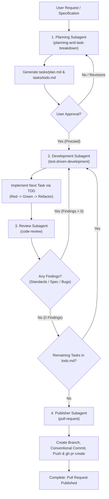

# Multi-Agent Iteration Loop (`agent-loop`)

An autonomous, multi-agent coordination skill that orchestrates four dedicated AI subagents—**Planning**, **Development**, **Review**, and **Publisher**—in a continuous, test-driven iteration loop to deliver and publish spec-compliant, high-standard software features.

---

## Overview & Core Philosophy

### Philosophy: Strict Separation of Concerns
The fundamental principle of `agent-loop` is **role isolation**:
- **The Coordinator Agent**: Acts strictly as the project manager and workflow orchestrator. The coordinator **MUST NOT** directly write implementation code, create source files, or edit application logic.
- **The Subagents**: Specialized agents spawned for distinct phases of the software development lifecycle (SDLC), operating under dedicated skill playbooks.

By enforcing strict boundaries, the loop eliminates common single-agent failure modes—such as skipping unit tests, rationalizing sloppy implementations, or opening half-finished pull requests without quality audits.

### When to Use
- **Feature Development**: Converting a specification, PRD, or user story into production-ready code.
- **Complex Refactoring**: Multi-step codebase refactorings requiring incremental test verification at each step.
- **Autonomous End-to-End Execution**: Hands-off development workflows that must culminate in a validated GitHub Pull Request without human micro-management.

---

## Workflow & Architecture

The skill manages a closed-loop state machine with quality gates at every transition:



### The 4 Phases

1. **Planning Phase (`planning` subagent)**
   - Analyzes requirements, explores codebase architecture, and identifies dependency trees.
   - Decomposes the initiative into small, vertically sliced tasks.
   - Produces `tasks/plan.md` (architectural design) and `tasks/todo.md` (actionable checklist) for user confirmation.
2. **Development Phase (`development` subagent)**
   - Picks the next unchecked task `[ ]` from `tasks/todo.md`.
   - Adheres strictly to **Test-Driven Development (TDD)**: writes a failing unit test first, writes minimal code to pass, verifies compilation, and updates task status to `[x]`.
3. **Review Phase (`review` subagent)**
   - Inspects `git diff` against five review axes: Correctness, Readability, Architecture, Security, and Performance.
   - If findings or standard violations exist, details are fed directly back to the development agent for remediation before moving forward.
4. **Publishing Phase (`publisher` subagent)**
   - Verifies `git status` clean state, validates all test suites, commits following [Conventional Commits](https://www.conventionalcommits.org/), pushes branch, and opens a GitHub Pull Request via `gh pr create`.

---

## Required Dependencies & Installation Links

To execute `agent-loop` and its underlying subagent tools, ensure the following command-line tools and runtimes are installed:

| Tool | Purpose | Download & Documentation |
| :--- | :--- | :--- |
| **Git** | Distributed version control and diff tracking | [git-scm.com](https://git-scm.com/) |
| **GitHub CLI (`gh`)** | Automated authentication, branch push, and PR creation | [cli.github.com](https://cli.github.com/) |
| **Python 3** | Runtime for auxiliary automation scripts (v3.10+) | [python.org/downloads](https://www.python.org/downloads/) |

### Installation Instructions

#### macOS (Homebrew)
```bash
# Install Git, GitHub CLI, and Python
brew install git gh python

# Authenticate GitHub CLI with your GitHub account
gh auth login
```

#### Ubuntu / Debian Linux
```bash
# Install Git and Python
sudo apt-get update
sudo apt-get install -y git python3 python3-pip

# Install GitHub CLI (official repository)
type -p curl >/dev/null || (sudo apt update && sudo apt install curl -y)
curl -fsSL https://cli.github.com/packages/githubcli-archive-keyring.gpg | sudo dd of=/usr/share/keyrings/githubcli-archive-keyring.gpg
sudo chmod go+r /usr/share/keyrings/githubcli-archive-keyring.gpg
echo "deb [arch=$(dpkg --print-architecture) signed-by=/usr/share/keyrings/githubcli-archive-keyring.gpg] https://cli.github.com/packages stable main" | sudo tee /etc/apt/sources.list.d/github-cli.list > /dev/null
sudo apt update
sudo apt install gh -y

# Authenticate GitHub CLI
gh auth login
```

#### Windows (Winget / Scoop)
```powershell
# Using Winget
winget install --id Git.Git -e --source winget
winget install --id GitHub.cli -e --source winget
winget install --id Python.Python.3.12 -e --source winget

# Authenticate GitHub CLI
gh auth login
```

---

## Usage & Examples

### Invoking via AI Assistant

When prompting an AI assistant or orchestrator in an agentic coding environment:

```text
Use the agent-loop skill to implement the following user feature:
"Add rate-limiting middleware to our Express API router based on client IP using a sliding window algorithm."
Ensure tasks are tracked in tasks/plan.md and tasks/todo.md, and open a PR when completed.
```

### Coordinator Execution Contract

The coordinator executes the loop step-by-step:

1. **Step 1: Plan Generation**
   - Coordinator invokes `planning` subagent.
   - Files created:
     ```
     tasks/
     ├── plan.md   # Architectural breakdown and design rationale
     └── todo.md   # [ ] Task 1, [ ] Task 2, [ ] Task 3
     ```
   - Coordinator pauses to confirm acceptance with the user.

2. **Step 2: Task-by-Task TDD Implementation**
   - Coordinator selects Task 1 and passes instructions to the `development` subagent.
   - Development agent writes `test_ratelimit.ts`, confirms failure (Red), implements `ratelimit.ts`, confirms pass (Green), and marks Task 1 `[x]`.

3. **Step 3: Quality Gate Review**
   - Coordinator triggers `review` subagent on the git diff.
   - If findings are reported (e.g. "Missing boundary check for IPv6 addresses"), coordinator prompts `development` subagent to address feedback.
   - When 0 findings remain, the loop advances to Task 2.

4. **Step 4: Publishing Pull Request**
   - Once all tasks in `tasks/todo.md` are `[x]`, coordinator delegates to `publisher` subagent.
   - The publisher executes:
     ```bash
     git checkout -b feat/sliding-window-rate-limiter
     git add src/ tests/
     git commit -m "feat(api): implement sliding-window rate limiting middleware"
     git push -u origin feat/sliding-window-rate-limiter
     gh pr create --title "feat(api): sliding-window rate limiter" --body "..."
     ```
   - The coordinator reports the pull request URL back to the user.

---

## File Structure & Subagent Skill References

```
agent-loop/
├── README.md               # Overview, dependencies, workflow, and instructions (this file)
└── SKILL.md                # Core execution rules, phase definitions, and constraints
```

### Linked Workspace Skills
`agent-loop` relies on subagents loading specialized workspace skills:

- **Planning Subagent**: [planning-and-task-breakdown](../planning-and-task-breakdown/SKILL.md) (Task sizing, vertical slicing, dependency ordering)
- **Development Subagent**: [test-driven-development](../test-driven-development/SKILL.md) (Red-Green-Refactor loop, interface seams, anti-patterns)
- **Review Subagent**: [code-review](../code-review/SKILL.md) (5-axis code quality gate, severity tagging)
- **Publisher Subagent**: [pull-request](../pull-request/SKILL.md) (Git branch isolation, Conventional Commits, GitHub CLI PR automation)
