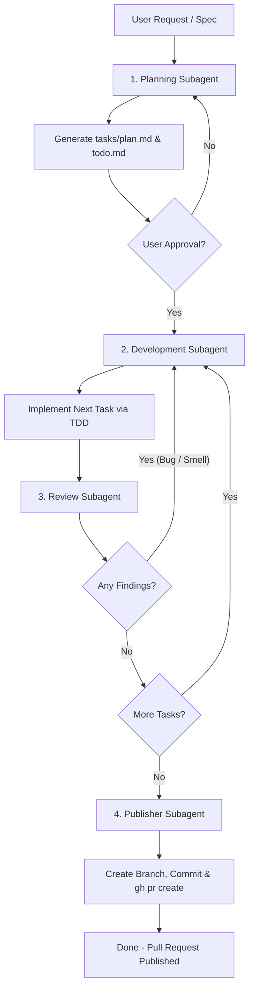

# Multi-Agent Iteration Loop

This skill coordinates four independent agents (`planning`, `development`, `review`, and `publisher`) in a continuous loop to deliver and publish spec-compliant, standard-abiding features.

## The Overarching Discipline
Every time the loop makes a change, follow:
1. **First Make it Work:** Minimal test-driven changes, single decisions in single places, laziness protocol.
2. **Then Make it Right:** Eliminate structural duplication, keep CRAP < 10, kill surviving mutants, apply architecture disciplines.
3. **Follow Practice:** Keep a log, guard context window, clean worktrees, commit in small ordered increments.

## Workflow Execution Steps

> [!IMPORTANT]
> **Coordinator Constraint**: The coordinator agent executing this skill MUST NOT write implementation code, create source files, or modify files in the codebase directly during the development phase. The coordinator is solely responsible for planning, orchestrating the loop, conducting code reviews, and managing publishing. All code changes and task implementations MUST be delegated to the spawned subagents.

### 1. Planning Phase
- **Spawn the `planning` subagent** to read the user request/specification and codebase structure.
- The `planning` agent will output `tasks/plan.md` (architecture, design, tasks) and `tasks/todo.md` (checkbox todo list).
- Once the plan is saved, present it to the user for feedback and approval.

### 2. Development Phase (Task Implementation)
- **Select the first incomplete task** from `tasks/todo.md`.
- **Spawn the `development` subagent** to implement that task in two parts:
  - **Part A: First Make it Work (`test-driven-development`)**:
    - Write a failing unit test first. See it fail for the expected reason.
    - Implement only the minimal code to pass the test.
    - Laziness protocol: ship the smallest edit that solves the problem.
  - **Part B: Then Make it Right (`refactoring`)**:
    - Pin behavior and run automated quality gates:
      - `risk-gate`: ensure function CRAP < 10.
      - `clone-check`: eliminate duplication >= 0.8.
      - `mutant-gate`: kill surviving mutants; delete dead code.
    - Apply domain and boundary discipline (pure functions, unrepresentable illegal states).
  - Update the status of the task in `tasks/todo.md` to completed `[x]`.

### 3. Review Phase (Quality Gates)
- **Spawn the `review` subagent** to perform standard and spec audits on the branch's git diff.
- The `review` agent outputs findings under `## Standards` and `## Spec` headers.
- **Evaluate results**:
  - **If there are findings** (e.g., hard violations or baseline smells):
    - Send a message to the `development` subagent containing the reviewer's report.
    - Instruct the developer to resolve the bugs or smells.
    - **Attack the Premise Protocol:** If two fixes that share one premise fail the same gate:
      1. Write that premise in one sentence.
      2. Count which actors hold the imbalance.
      3. Remove the assignment.
      4. Do not start another fix until this diagnosis is written down.
    - Rerun the `review` agent once the developer has updated the branch.
  - **If there are 0 findings**:
    - Check `tasks/todo.md` for the next incomplete task.
    - If tasks remain, loop back to **Step 2**.
    - If all tasks are completed, proceed to **Step 4**.

### 4. Publishing Phase (Deployment Gate)
- **Spawn the `publisher` subagent** to automate the integration and deployment lifecycle.
- The `publisher` agent must:
  - Perform worktree cleanup (safe removal of temporary files, confirm no active processes need them).
  - Verify `git status` and stage all changed files.
  - Commit files using the Conventional Commits syntax and push to origin.
  - Execute `gh pr create` with standard metadata titles/descriptions to open the GitHub Pull Request.
  - Return the direct URL link to the Pull Request.

## Practice Guidelines

- **Keep a Log:** Keep a log of every action you take and the reason you took it. Report that log upon completion of the loop.
- **Guard the Context Window:** Keep the coordinator thread small. Delegate heavy work and analysis to subagents, retaining only concise summaries in the main thread.
- **Worktree Cleanup:** Find what is safe to remove, confirm nothing still in use needs it, then reclaim disk. Uncommitted work waits for an explicit user decision.

## Exit Criteria
- All tasks in `tasks/todo.md` are marked `[x]`.
- The `review` agent reports 0 standard violations or spec omissions.
- All unit and integration tests in the test suite pass successfully.
- Quality gates (`risk-gate`, `clone-check`, `mutant-gate`) pass without violations.
- The `publisher` agent has successfully pushed and opened a GitHub Pull Request, sharing its URL.

## Sub-Agent Skill References

To ensure execution consistency, each sub-agent in this loop is dedicated to executing a specific workspace skill. They must load and re-use the following guides:

*   **Planning Sub-Agent**:
    *   Primary Skill: [planning-and-task-breakdown](../planning-and-task-breakdown/SKILL.md) (analyzes dependencies, partitions vertical slices, foundational thinking).
*   **Development Sub-Agent**:
    *   Primary Skills:
        *   [test-driven-development](../test-driven-development/SKILL.md) (drives test-first RED-GREEN loops at public boundaries).
        *   [refactoring](../refactoring/SKILL.md) (enforces CRAP < 10, duplication < 0.8, mutation killing).
*   **Review Sub-Agent**:
    *   Primary Skill: [code-review](../code-review/SKILL.md) (performs audits across the 5 axes and verifies quality gates).
*   **Publisher Sub-Agent**:
    *   Primary Skill: [pull-request](../pull-request/SKILL.md) (automates worktree cleanup, commits, pushes, and GitHub CLI PR creation).

