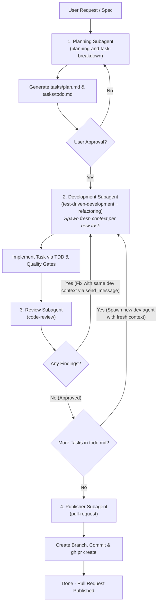

# Multi-Agent Iteration Loop

This skill coordinates four independent subagents (`planning`, `development`, `review`, and `publisher`) in a continuous loop to deliver and publish spec-compliant, standard-abiding features.



## Coordinator Constraints & Disciplines

> [!IMPORTANT]
> **Strict Pure Orchestration**:
> 1. **Zero Task-Related Actions**: The orchestrator MUST NOT read codebase files, search or grep code, explore project architecture, or inspect git diffs. All exploration, reading, implementation, testing, and reviewing belong strictly to subagents.
> 2. **Zero Code Changes**: The orchestrator MUST NOT write code, create source files, edit application logic, or run execution commands.
> 3. **Pass Raw Task Context Directly**: Pass user requests, specs, and file paths directly to the subagents without pre-reading, summarizing, or distilling them.
> 4. **Force Skill Loading (No Instruction Inlining)**: The orchestrator MUST NOT summarize, fragment, or paraphrase skill instructions in subagent prompts. Instead, the orchestrator MUST explicitly instruct each subagent to read and execute its designated skill (`SKILL.md`).
> 5. **Subagent Context Lifecycle (Isolation vs Continuity)**:
>    - **New Task = Fresh Subagent**: For every new task in `tasks/todo.md`, ALWAYS spawn a new development subagent via `invoke_subagent`. Never reuse a development agent across different tasks to avoid context pollution and token bloat.
>    - **Review Remediation = Same Agent Context**: If the review reports findings, ALWAYS message the same development subagent instance via `send_message` using its `conversationId`. Do not spawn a new agent for post-review fixes.

## Workflow Execution Steps

### 1. Planning Phase
- **Action**: Spawn the `planning` subagent using `invoke_subagent`. Pass the user's raw feature request/specification verbatim.
- **Skill Mandate**: Force the subagent to load and follow [planning-and-task-breakdown](../planning-and-task-breakdown/SKILL.md).
- **Subagent Prompt Directive**:
  ```text
  You are the Planning Subagent for agent-loop.
  MANDATORY: Your very first step is to read and strictly execute the skill at `planning-and-task-breakdown/SKILL.md` (or skill `planning-and-task-breakdown`).
  Do NOT rely on abbreviated instructions or skip reading the skill.
  Explore the codebase, analyze requirements, and produce:
  1. `tasks/plan.md` (architectural design and breakdown)
  2. `tasks/todo.md` (checkbox checklist of implementation tasks)
  Return the plan summary and todo list to the coordinator when done.

  <USER_REQUEST>
  {RAW_USER_REQUEST_OR_SPEC}
  </USER_REQUEST>
  ```
- **Handoff**: Once the planning subagent returns `tasks/plan.md` and `tasks/todo.md`, present the plan to the user for approval before starting implementation.

### 2. Development Phase (Task Implementation)
- **Action**: Check which task is next in `tasks/todo.md`.
  - **New Task**: ALWAYS spawn a **brand new** `development` subagent instance using `invoke_subagent` to ensure clean, isolated context for each task. Never reuse a development subagent from a previous task.
  - Record the returned `conversationId` for this task.
- **Skill Mandate**: Force the subagent to load and follow [test-driven-development](../test-driven-development/SKILL.md) and [refactoring](../refactoring/SKILL.md).
- **Subagent Prompt Directive**:
  ```text
  You are the Development Subagent for agent-loop.
  MANDATORY: You must execute this task using two designated workspace skills in order. First read their complete SKILL.md files:
  1. `test-driven-development/SKILL.md` (for the test-first Red-Green cycle at public boundaries)
  2. `refactoring/SKILL.md` (for automated quality gates: CRAP < 10, duplication elimination, mutation killing)
  Do NOT skip reading these skills. Strictly follow their protocols.

  Task to implement:
  {CURRENT_TASK_DESCRIPTION}

  References:
  - Plan: tasks/plan.md
  - Checklist: tasks/todo.md

  When done, mark the task as completed [x] in `tasks/todo.md` and report a concise summary of the changes made and tests passed.
  ```

### 3. Review Phase (Quality Gates)
- **Action**: Spawn the `review` subagent to review the git diff for the changes introduced.
- **Skill Mandate**: Force the subagent to load and follow [code-review](../code-review/SKILL.md).
- **Subagent Prompt Directive**:
  ```text
  You are the Review Subagent for agent-loop.
  MANDATORY: Your very first step is to read and strictly execute the skill at `code-review/SKILL.md`.
  Audit the current git diff across the 5 axes (Correctness, Readability, Architecture, Security, Performance) and quality gates.
  Output your findings categorized under `## Standards` and `## Spec` headers.
  Report whether the review passes with 0 findings or list any actionable findings to remediate.
  ```
- **Evaluate results**:
  - **If there are findings**: Message the **same** `development` subagent instance (using `send_message` with its task `conversationId`) passing the reviewer's findings directly so it remediates within the same development context. Re-run the `review` subagent once the developer has remediated the issues.
  - **If there are 0 findings**: Advance to the next task in `tasks/todo.md` (back to Step 2, where a **new** development subagent will be spawned). If all tasks are completed `[x]`, proceed to Step 4.

### 4. Publishing Phase (Deployment Gate)
- **Action**: Spawn the `publisher` subagent to finalize, commit, push, and create the PR.
- **Skill Mandate**: Force the subagent to load and follow [pull-request](../pull-request/SKILL.md).
- **Subagent Prompt Directive**:
  ```text
  You are the Publisher Subagent for agent-loop.
  MANDATORY: Your very first step is to read and strictly execute the skill at `pull-request/SKILL.md`.
  Perform worktree cleanup, stage files, commit using Conventional Commits, push the feature branch to origin, and run `gh pr create` with clear titles and descriptions.
  Return the final Pull Request URL.
  ```
- **Handoff**: Provide the user with the direct link to the published Pull Request.

## Practice Guidelines

- **Zero Inspection by Coordinator**: The coordinator thread stays clean and minimal. Never load or read application source files in the orchestrator session.
- **Pass Pure Payloads**: Hand off unedited user instructions and artifacts directly to subagents.
- **Strict Skill Enforcement**: Subagents have rich, detailed instructions in their respective skill folders. Force subagents to read their `SKILL.md` instead of inlining summarized versions.
- **Context Boundaries vs. Remediation Continuity**: Enforce fresh subagent context for each new task to eliminate context bloat and hallucination accumulation. Maintain context continuity only during review remediation by messaging the same subagent instance via `send_message`.
- **Keep a Log**: Track workflow transitions and reasons in a lightweight orchestrator log.

## Exit Criteria
- All tasks in `tasks/todo.md` are marked `[x]`.
- The `review` agent reports 0 standard violations or spec omissions.
- All unit and integration tests in the test suite pass successfully.
- Quality gates (`risk-gate`, `clone-check`, `mutant-gate`) pass without violations.
- The `publisher` agent has successfully pushed and opened a GitHub Pull Request, sharing its URL.

## Sub-Agent Skill Directory Mapping

| Sub-Agent | Primary Skills | Skill Path |
| :--- | :--- | :--- |
| **Planning Sub-Agent** | `planning-and-task-breakdown` | [planning-and-task-breakdown](../planning-and-task-breakdown/SKILL.md) |
| **Development Sub-Agent** | `test-driven-development`<br/>`refactoring` | [test-driven-development](../test-driven-development/SKILL.md)<br/>[refactoring](../refactoring/SKILL.md) |
| **Review Sub-Agent** | `code-review` | [code-review](../code-review/SKILL.md) |
| **Publisher Sub-Agent** | `pull-request` | [pull-request](../pull-request/SKILL.md) |
