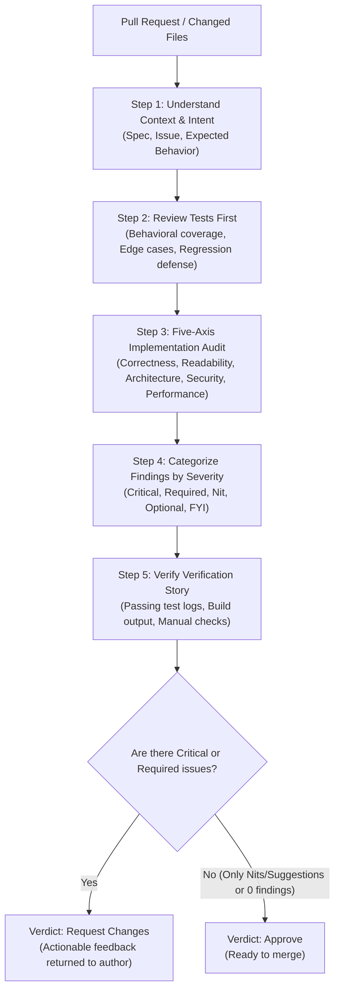

# Multi-Axis Code Review (`code-review`)

A systematic, multi-dimensional code review framework with explicit quality gates. Evaluates software changes across five core engineering axes—**Correctness**, **Readability & Simplicity**, **Architecture**, **Security**, and **Performance**—before any code merges into the main branch.

---

## Overview & Core Philosophy

### The Approval Standard
> **Approve a change when it definitely improves overall code health, even if it isn't perfect.**

Perfect code does not exist; software development is an iterative discipline of continuous improvement. Code review must never be weaponized to enforce personal stylistic idiosyncrasies or block changes that clearly elevate repository standards. However, reviewers must maintain uncompromising vigilance regarding security, system invariants, test validity, and architectural debt.

### Core Principles
1. **Zero Unreviewed Merges**: Every change undergoes review—no exceptions.
2. **Review Tests First**: Tests communicate intent, boundary assumptions, and coverage before implementation details are scrutinized.
3. **Change Sizing Discipline**: Keep changes between 100 and 300 lines. Changes exceeding 1,000 lines must be split into logical stacks or slices.
4. **Honesty & Precision**: Avoid sycophancy or rubber-stamping ("LGTM"). Quantify risks and label every comment with standardized severity tags.
5. **Dead Code Hygiene**: Refactorings must identify and clean up orphaned functions, variables, and shim layers.

### When to Use
- **Pull Request Reviews**: Evaluating PRs authored by teammates, contributors, or automated agents.
- **Agent Self-Auditing**: Serving as an independent verification gate in multi-agent workflows (e.g., `agent-loop`).
- **Post-Implementation & Refactoring**: Verifying regression risks, boundary security, and error-handling paths after major code changes.

---

## Workflow & Architecture



### The Multi-Model Review Pattern
To overcome model blind spots, multi-agent systems leverage independent LLMs:

```
┌─────────────────┐       ┌─────────────────┐       ┌─────────────────┐       ┌─────────────────┐
│     Model A     │ ────> │     Model B     │ ────> │     Model A     │ ────> │  Human Reviewer │
│  (Writes Code)  │       │ (Audits & Flags)│       │(Applies Fixes)  │       │ (Final Decision)│
└─────────────────┘       └─────────────────┘       └─────────────────┘       └─────────────────┘
```

---

## The Five Review Axes

| Axis | Focus Questions | Red Flags |
| :--- | :--- | :--- |
| **1. Correctness** | Does the code satisfy the spec? Are edge cases (null, empty, bounds) and error paths handled? Are state machines valid? | Off-by-one errors, unhandled exceptions, race conditions, tests asserting mocks rather than behavior. |
| **2. Readability & Simplicity** | Can a new engineer understand this without explanation? Is it minimal? Could 200 lines be written in 50? | Nested ternaries, deep callback pyramids, premature generalizations, no-op `_unused` variables. |
| **3. Architecture** | Does the change preserve module boundaries? Do dependencies flow unidirectionally? Does it reuse existing patterns? | Circular dependencies, tight coupling, leaky abstractions, bypassing existing shared utilities. |
| **4. Security** | Is input validated and sanitized at boundaries? Are secrets exposed? Are queries parameterized? Are auth checks verified? | String-interpolated SQL/shell commands, unescaped HTML/XSS, secrets committed to logs or code. |
| **5. Performance** | Are database and network queries bounded? Are asynchronous APIs used properly? Are memory hot paths kept light? | N+1 queries, unindexed filters, unbounded `SELECT *` operations, missing pagination, unnecessary UI re-renders. |

### Severity Taxonomy

Review feedback must be prefixed with standardized severity indicators:

| Prefix | Meaning | Author Action Required |
| :--- | :--- | :--- |
| *(No prefix)* | **Required Change** | Must be addressed before merging. |
| **`Critical:`** | **Blocker** | High-risk vulnerability, data corruption, or broken core functionality. Blocks merge immediately. |
| **`Nit:`** | **Minor / Polish** | Optional. Author may address or ignore (e.g., formatting preference, minor typo in comment). |
| **`Optional:`** / **`Consider:`** | **Suggestion** | Non-blocking recommendation for future optimization or alternative design. |
| **`FYI:`** | **Informational** | Contextual note; no code action required. |

---

## Required Dependencies & Installation Links

To conduct diff analysis, run linters, and automate PR reviews, install the following command-line tools:

| Tool | Purpose | Download & Documentation |
| :--- | :--- | :--- |
| **Git** | Inspecting diffs, commit histories, and worktrees (`git diff`, `git log`, `git blame`) | [git-scm.com](https://git-scm.com/) |
| **GitHub CLI (`gh`)** | Reviewing, commenting, approving, and checking out PRs from the terminal | [cli.github.com](https://cli.github.com/) |
| **ripgrep (`rg`)** | Fast pattern searching for dead code and dependency tracing across large codebases | [github.com/BurntSushi/ripgrep](https://github.com/BurntSushi/ripgrep) |
| **Python 3** | Runtime for repository scripts and test runners (v3.10+) | [python.org/downloads](https://www.python.org/downloads/) |

### Installation Instructions

#### macOS (Homebrew)
```bash
# Install Git, GitHub CLI, ripgrep, and Python
brew install git gh ripgrep python

# Authenticate GitHub CLI
gh auth login
```

#### Ubuntu / Debian Linux
```bash
# Install Git, ripgrep, and Python
sudo apt-get update
sudo apt-get install -y git ripgrep python3 python3-pip

# Install GitHub CLI (official repository)
type -p curl >/dev/null || (sudo apt update && sudo apt install curl -y)
curl -fsSL https://cli.github.com/packages/githubcli-archive-keyring.gpg | sudo dd of=/usr/share/keyrings/githubcli-archive-keyring.gpg
sudo chmod go+r /usr/share/keyrings/githubcli-archive-keyring.gpg
echo "deb [arch=$(dpkg --print-architecture) signed-by=/usr/share/keyrings/githubcli-archive-keyring.gpg] https://cli.github.com/packages stable main" | sudo tee /etc/apt/sources.list.d/github-cli.list > /dev/null
sudo apt update
sudo apt install gh -y

# Authenticate GitHub CLI
gh auth login
```

#### Windows (Winget / Scoop)
```powershell
# Using Winget
winget install --id Git.Git -e --source winget
winget install --id GitHub.cli -e --source winget
winget install --id BurntSushi.ripgrep.MSVC -e --source winget
winget install --id Python.Python.3.12 -e --source winget

# Authenticate GitHub CLI
gh auth login
```

---

## Usage & Examples

### Developer / CLI Usage

#### Reviewing a PR Locally with GitHub CLI and Git
```bash
# 1. Fetch and checkout the pull request
gh pr checkout 42

# 2. View full branch diff against main
git diff main...HEAD

# 3. View changed files and summary stats
git diff --stat main...HEAD

# 4. Search for newly added unparameterized queries or potential security risks
git diff main...HEAD | rg -i "exec|eval|query|select"

# 5. Submit review from CLI
gh pr review --comment -b "Review complete. See inline comments."
```

### AI Agent Prompt Example

When invoking an AI reviewer subagent:

```text
Perform a multi-axis code review on the current git diff against 'origin/main'.
Spec Requirements:
- Add webhook signature verification using HMAC-SHA256.
- Reject requests with timestamps older than 5 minutes.

Evaluate the diff across Correctness, Readability, Architecture, Security, and Performance.
Format findings using standardized severity prefixes (Critical:, Nit:, Optional:, or no prefix for required changes).
End with an explicit verdict: APPROVE or REQUEST CHANGES.
```

### Sample Output Report

```markdown
## Review: feat(auth): webhook HMAC signature verification

### Context & Test Coverage
- [x] Verified tests exist in `tests/test_webhook_auth.py`.
- [x] Edge case covered: timestamp replay attacks older than 300s are rejected.

### Findings

#### Security
- **Critical:** In `src/auth/webhook.py:48`: `secret_token == expected_token` uses standard equality, which is vulnerable to timing attacks. Use `hmac.compare_digest(secret_token, expected_token)` instead.

#### Correctness
- `src/auth/webhook.py:22`: Missing null check on the `X-Signature-256` header. If the header is missing, `request.headers["X-Signature-256"]` raises `KeyError` resulting in an unhandled 500 error instead of a 401 Unauthorized.

#### Readability
- **Nit:** `src/auth/webhook.py:65`: Variable `t` should be renamed to `parsed_timestamp` for clarity.

### Verdict
- **REQUEST CHANGES** — 1 Critical vulnerability and 1 unhandled exception must be addressed.
```

---

## File Structure

```
code-review/
├── README.md               # Overview, dependencies, review taxonomy, and usage (this file)
└── SKILL.md                # Five-axis guide, checklists, sizing limits, and review rationalizations
```
