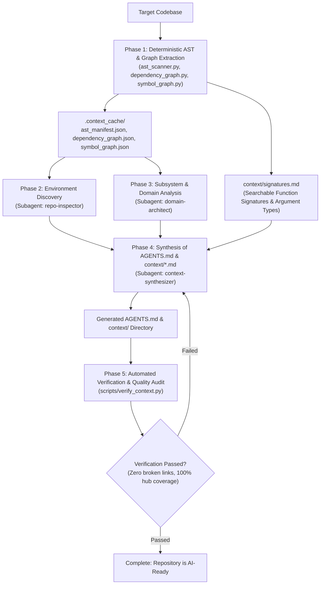

# Codebase Context Generator (`codebase-context-generator`)

An automated codebase intelligence skill that converts any brownfield, legacy, or non-AI-adapted repository into a structured, AI-ready workspace.

By fusing **deterministic Tree-sitter AST extraction** with **semantic multi-agent synthesis**, this skill generates a standardized operational instruction file (`AGENTS.md`) and a comprehensive architectural knowledge base (`context/`), complete with searchable function signatures and call graphs.

---

## Overview & Core Philosophy

### Philosophy: Deterministic Parsing Before Semantic Synthesis
Large language models struggle when forced to read thousands of raw code files to understand unfamiliar repositories. They hit context window limits, omit subtle dependencies, hallucinate nonexistent functions, and consume massive amounts of tokens.

`codebase-context-generator` addresses this via a **hybrid two-stage approach**:
1. **Deterministic AST & Graph Extraction**: Fast Python scripts leverage [Tree-sitter](https://tree-sitter.github.io/tree-sitter/) to extract syntax trees, class structures, interface definitions, call graphs, and topological module dependencies without calling an LLM.
2. **Targeted Agentic Synthesis**: Specialized subagents ingest the compact, structured AST manifests to produce high-density documentation (`AGENTS.md` and `context/*.md`).
3. **Automated Verification**: Deterministic link checkers and coverage auditors verify that all entrypoints, hub modules, and doc links are intact before completion.

### When to Use
- **Onboarding AI Agents to Brownfield Projects**: Preparing a legacy or unfamiliar repository for AI-assisted development.
- **Repository Modernization & Audits**: Creating clean system architecture documentation, dependency graphs, and code maps.
- **Fast Symbol & Call Graph Navigation**: Enabling developers and agents to trace callers, callees, and function signatures via CLI without loading dozens of source files.

---

## Workflow & Architecture



### Generated Repository Artifacts

When executed, the skill populates the repository with the following structure:

```
target-repo/
├── AGENTS.md                   # Single source of truth for AI agents (commands, conventions, invariants)
├── .context_cache/             # Machine-readable AST and dependency indices (git-ignored)
│   ├── ast_manifest.json       # Parsed classes, functions, exports, and imports by file
│   ├── dependency_graph.json   # Internal topological graph, hub modules, and entrypoints
│   └── symbol_graph.json       # Function-level call hierarchy and reference graph
└── context/                    # Human- and AI-readable documentation directory
    ├── index.md                # System navigation map and table of contents
    ├── architecture.md         # Subsystems, Mermaid diagrams, and request lifecycles
    ├── modules.md              # Detailed inventory of core modules and AST symbols
    ├── dependencies.md         # Internal imports and third-party package inventory
    ├── conventions.md          # Code standards, error handling patterns, and test practices
    └── signatures.md           # Searchable function and method signature cheat sheet
```

---

## Required Dependencies & Installation Links

`codebase-context-generator` requires [Python 3](https://www.python.org/) and the [Tree-sitter](https://tree-sitter.github.io/tree-sitter/) parsing engine along with language-specific grammar packages.

### Required Software & Packages

| Component | Description | Download & Documentation |
| :--- | :--- | :--- |
| **Python 3** | Python runtime environment (v3.10 or higher required) | [python.org/downloads](https://www.python.org/downloads/) |
| **Git** | Version control system for repository scanning | [git-scm.com](https://git-scm.com/) |
| **tree-sitter** | Core Python Tree-sitter parser bindings (v0.22+) | [pypi.org/project/tree-sitter](https://pypi.org/project/tree-sitter/) |
| **pytest** | Test runner for executing internal script unit tests | [docs.pytest.org](https://docs.pytest.org/) |

### Tree-sitter Language Grammar Packages

Install the specific grammar packages corresponding to the languages in your target repository:

| Language | PyPI Package Link | Pip Package Name |
| :--- | :--- | :--- |
| **Python** | [tree-sitter-python](https://pypi.org/project/tree-sitter-python/) | `tree-sitter-python` |
| **TypeScript / TSX** | [tree-sitter-typescript](https://pypi.org/project/tree-sitter-typescript/) | `tree-sitter-typescript` |
| **JavaScript** | [tree-sitter-javascript](https://pypi.org/project/tree-sitter-javascript/) | `tree-sitter-javascript` |
| **Go** | [tree-sitter-go](https://pypi.org/project/tree-sitter-go/) | `tree-sitter-go` |
| **Rust** | [tree-sitter-rust](https://pypi.org/project/tree-sitter-rust/) | `tree-sitter-rust` |
| **Java** | [tree-sitter-java](https://pypi.org/project/tree-sitter-java/) | `tree-sitter-java` |
| **PHP** | [tree-sitter-php](https://pypi.org/project/tree-sitter-php/) | `tree-sitter-php` |
| **Dart** | [tree-sitter-dart-orchard](https://pypi.org/project/tree-sitter-dart-orchard/) | `tree-sitter-dart-orchard` |
| **C** | [tree-sitter-c](https://pypi.org/project/tree-sitter-c/) | `tree-sitter-c` |
| **C++** | [tree-sitter-cpp](https://pypi.org/project/tree-sitter-cpp/) | `tree-sitter-cpp` |
| **C#** | [tree-sitter-c-sharp](https://pypi.org/project/tree-sitter-c-sharp/) | `tree-sitter-c-sharp` |
| **Ruby** | [tree-sitter-ruby](https://pypi.org/project/tree-sitter-ruby/) | `tree-sitter-ruby` |

### Installation Instructions

#### 1. System Runtime Setup

**macOS (Homebrew):**
```bash
brew install python git
```

**Ubuntu / Debian Linux:**
```bash
sudo apt update
sudo apt install -y python3 python3-pip git
```

**Windows:**
```powershell
winget install --id Python.Python.3.12 -e --source winget
winget install --id Git.Git -e --source winget
```

#### 2. Python Package Installation

Install core dependencies and common language grammars in one step:

```bash
# Core parser and testing framework
pip install tree-sitter pytest

# Recommended bundle of popular language grammars
pip install \
  tree-sitter-python \
  tree-sitter-typescript \
  tree-sitter-javascript \
  tree-sitter-go \
  tree-sitter-rust \
  tree-sitter-java \
  tree-sitter-php \
  tree-sitter-c \
  tree-sitter-cpp \
  tree-sitter-c-sharp \
  tree-sitter-ruby \
  tree-sitter-dart-orchard
```

---

## Usage & Examples

### Step 1: Deterministic Extraction Phase

Run the scripts against the target codebase:

```bash
# Set your target repository path
TARGET_REPO="/path/to/target/project"

# 1. Parse AST symbols across the target codebase
python3 codebase-context-generator/scripts/ast_scanner.py \
  --root "$TARGET_REPO" \
  --summary

# 2. Build topological dependency and hub graph
python3 codebase-context-generator/scripts/dependency_graph.py \
  --manifest "$TARGET_REPO/.context_cache/ast_manifest.json"

# 3. Generate symbol call graph and export function signatures
python3 codebase-context-generator/scripts/symbol_graph.py \
  --manifest "$TARGET_REPO/.context_cache/ast_manifest.json" \
  --save-graph "$TARGET_REPO/.context_cache/symbol_graph.json" \
  --export-signatures "$TARGET_REPO/context/signatures.md"
```

### Step 2: Instant Symbol & Call Hierarchy Querying (CLI)

Agents and developers can query function signatures, arguments, callers, and callees directly from the terminal without opening source files:

```bash
# Look up a function's signature and file location
python3 codebase-context-generator/scripts/symbol_graph.py --find "authenticate_user"

# Trace all functions that call 'authenticate_user'
python3 codebase-context-generator/scripts/symbol_graph.py --callers "authenticate_user"

# Trace all functions that 'authenticate_user' calls
python3 codebase-context-generator/scripts/symbol_graph.py --callees "authenticate_user"
```

### Step 3: Synthesis Phase (Subagents)

Spawn AI subagents using the templates in `codebase-context-generator/references/`:
1. **`Repo Inspector`**: Reads package manifests (`package.json`, `Cargo.toml`, `pyproject.toml`) to extract canonical build, test, and lint commands.
2. **`Domain Architect`**: Ingests `.context_cache/dependency_graph.json` to synthesize subsystem architecture and request lifecycles.
3. **`Context Synthesizer`**: Compiles `AGENTS.md` and `context/*.md` using `references/agents_template.md` and `references/context_templates.md`.

### Step 4: Verification Gate

Run the automated validation script to verify document health:

```bash
python3 codebase-context-generator/scripts/verify_context.py --root "$TARGET_REPO"
```

**Automated Quality Checks Verified:**
- Presence of `AGENTS.md` and required subheadings (Commands, Architecture, Invariants).
- Presence of all 5 core `context/*.md` documents.
- Complete relative markdown link validity (zero 404 or dead anchor links).
- Absence of unresolved placeholders (e.g. `TODO`, `<fill in>`, `[TBD]`).
- 100% coverage of architectural hub modules identified in `dependency_graph.json`.

---

## File Structure

```
codebase-context-generator/
├── README.md                           # Comprehensive documentation and installation guide (this file)
├── SKILL.md                            # Agent instructions, phase breakdown, prompts, and quality gates
├── references/
│   ├── agents_template.md              # Markdown blueprint for the root AGENTS.md file
│   └── context_templates.md            # Markdown blueprints for context/*.md documents
├── scripts/
│   ├── common.py                       # Shared Tree-sitter loaders, ignore rules, and file discovery
│   ├── ast_scanner.py                  # Tree-sitter AST extraction across 12+ programming languages
│   ├── dependency_graph.py             # Internal import resolver and topological hub analyzer
│   ├── symbol_graph.py                 # Call graph generator and CLI symbol navigation tool
│   └── verify_context.py               # Deterministic markdown link and documentation auditor
└── tests/
    ├── test_ast_scanner.py             # Unit tests for AST parsing and language detection
    ├── test_dependency_graph.py        # Unit tests for topological sort and hub detection
    ├── test_symbol_graph.py            # Unit tests for caller/callee indexing and queries
    └── test_verify_context.py          # Unit tests for the context validation script
```

### Running Internal Tests
To verify the scripts in this skill:
```bash
python3 -m unittest discover codebase-context-generator/tests
# Or if pytest is installed:
pytest codebase-context-generator/tests
```
