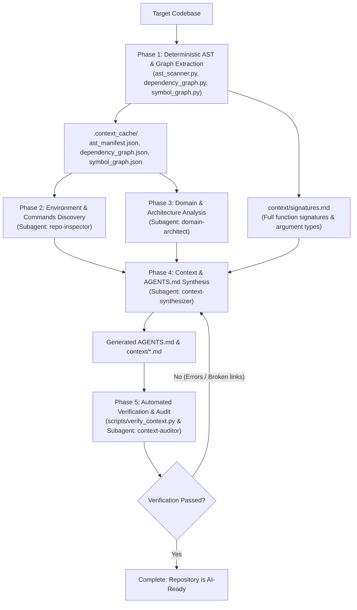

# Codebase Context Generator

This skill transforms any brownfield or non-AI-adapted codebase into an AI-ready repository. It generates:
1. **`AGENTS.md`**: The primary operational instruction manual for AI agents operating in the repository.
2. **`context/`**: A structured documentation directory detailing architecture, modules, dependencies, and engineering conventions.

The skill combines deterministic Tree-sitter AST parsing via predefined Python scripts with semantic multi-agent synthesis to produce accurate, information-dense documentation without blowing token budgets.



---

## Workflow Execution Steps

### Phase 1: Deterministic AST & Dependency Extraction

Run the predefined Python helper scripts to scan the codebase using Tree-sitter and build the structural manifests.

```bash
# 1. Run Tree-sitter AST scanner across target codebase
python3 codebase-context-generator/scripts/ast_scanner.py --root <target-repo-path> --summary

# 2. Build internal import and dependency graph
python3 codebase-context-generator/scripts/dependency_graph.py --manifest <target-repo-path>/.context_cache/ast_manifest.json

# 3. Build symbol & call graph, and export signatures cheat sheet
python3 codebase-context-generator/scripts/symbol_graph.py \
  --manifest <target-repo-path>/.context_cache/ast_manifest.json \
  --save-graph <target-repo-path>/.context_cache/symbol_graph.json \
  --export-signatures <target-repo-path>/context/signatures.md
```

**Artifacts Generated**:
- `.context_cache/ast_manifest.json`: Complete file-by-file AST symbol index (classes, methods, functions, interfaces, structs, imports, exports).
- `.context_cache/dependency_graph.json`: Internal topological graph, hub modules, entrypoints, and third-party dependencies.
- `.context_cache/symbol_graph.json`: Function-level and method-level call and reference graph with argument types and caller/callee cross-references.
- `context/signatures.md`: Searchable signature cheat sheet by file and module.

### Fast Symbol & Signature Navigation for Agents
During any subsequent coding or investigation task, agents can instantly query function signatures and trace call hierarchies without opening multiple files:

```bash
# Find function signature, argument types, return type, and location
python3 codebase-context-generator/scripts/symbol_graph.py --find "function_name"

# Trace who calls this function
python3 codebase-context-generator/scripts/symbol_graph.py --callers "function_name"

# Trace what this function calls
python3 codebase-context-generator/scripts/symbol_graph.py --callees "function_name"
```

---

### Phase 2: Environment & Commands Discovery

Spawn a subagent (or inspect configuration manifests) to discover the verified developer toolchain.

**Subagent Role**: `Repo Inspector`
**Prompt Template**:
```markdown
Inspect the repository configurations, build files, and package manifests (e.g. package.json, pyproject.toml, Cargo.toml, go.mod, Makefile, Dockerfile, etc.) in the workspace.
Identify and verify:
1. Exact package manager and runtime versions.
2. Build commands.
3. Test commands (full suite and single test file).
4. Lint and type-check commands.
5. Primary application entry point.

Return a concise YAML summary of these verified commands.
```

---

### Phase 3: Subsystem & Domain Analysis

Use the AST manifest and dependency graph to identify core system boundaries without reading raw files.

**Subagent Role**: `Domain Architect`
**Prompt Template**:
```markdown
Review `.context_cache/ast_manifest.json` and `.context_cache/dependency_graph.json`.
Analyze:
1. Core entrypoints (e.g., CLI binaries, web routers, server bootstraps).
2. Key hub modules (files with high in-degree that serve as shared utilities or state).
3. The layered architecture (presentation, domain logic, data persistence, integrations).
4. Major data models and primary business workflows.

Synthesize an architectural summary describing how data flows through the application from entry to completion.
```

*(For large multi-service or monorepo projects, spawn parallel subagents per package or directory.)*

---

### Phase 4: Context & AGENTS.md Synthesis

Generate the target documentation using the templates in `codebase-context-generator/references/`:
- `codebase-context-generator/references/agents_template.md`
- `codebase-context-generator/references/context_templates.md`

**Subagent Role**: `Context Synthesizer`
**Prompt Template**:
```markdown
Generate the following files for the target repository:
1. `AGENTS.md` at repository root (following references/agents_template.md).
2. `context/index.md` (Table of contents and navigation map).
3. `context/architecture.md` (System design, Mermaid diagram, subsystem layers, request lifecycle).
4. `context/modules.md` (Module-by-module breakdown using AST symbols, classes, functions, and interfaces).
5. `context/dependencies.md` (Internal call graph, hubs, and third-party package inventory).
6. `context/conventions.md` (Code style, error handling patterns, invariants, testing strategy).

Ensure all markdown links use relative paths, all code blocks have valid syntax, and no placeholder text remains.
```

---

### Phase 5: Automated Verification & Quality Audit

Run the validation script to verify link integrity, section completeness, and AST symbol coverage.

```bash
python3 codebase-context-generator/scripts/verify_context.py --root <target-repo-path>
```

**Quality Gates**:
- `AGENTS.md` exists and contains all required sections (Overview, Commands, Architecture, Invariants).
- `context/` exists with `index.md`, `architecture.md`, `modules.md`, `dependencies.md`, and `conventions.md`.
- Zero broken local markdown links.
- No unresolved placeholders (`TODO`, `<insert...>`, etc.).
- All hub files and key entrypoints are documented in `context/modules.md`.

If any check fails, loop back to **Phase 4** to fix errors until `verify_context.py` outputs `PASS`.

---

## Post-Change Maintenance (Incremental Updates)

Whenever an AI agent modifies existing code or adds new files in the codebase, the symbol and call graphs must not go stale. As instructed in `AGENTS.md`, agents should either rerun the scripts directly or invoke a lightweight maintenance subagent:

**Maintenance Subagent Role**: `Context Maintainer`
**Prompt Template**:
```markdown
Recent code edits were made in the repository. Refresh the codebase context:
1. Run ast_scanner.py, dependency_graph.py, and symbol_graph.py to rebuild .context_cache/ and context/signatures.md.
2. If new components, APIs, or architectural flows were introduced, incrementally update context/modules.md and context/architecture.md.
3. Run verify_context.py to ensure zero broken links and full coverage.
```

---

## Reference Guide

- [AGENTS.md Template](./references/agents_template.md)
- [Context Documentation Templates](./references/context_templates.md)
- [AST Scanner Script](./scripts/ast_scanner.py)
- [Dependency Graph Script](./scripts/dependency_graph.py)
- [Symbol Graph & Signature Navigator Script](./scripts/symbol_graph.py)
- [Context Verifier Script](./scripts/verify_context.py)
