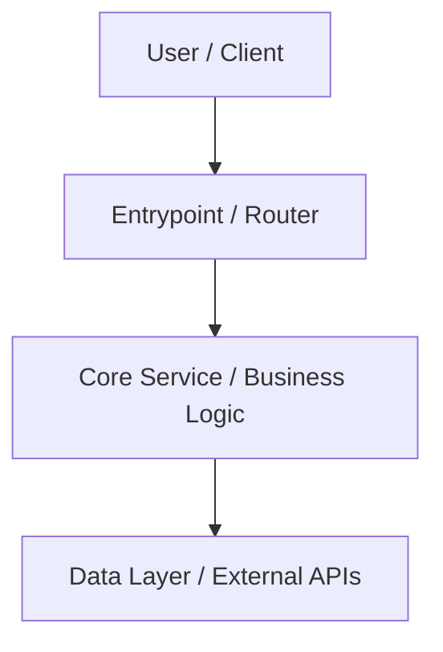

# Context Documentation Templates

These templates define the expected schema for files generated in the target codebase's `context/` directory.

---

## 1. `context/index.md`

```markdown
# Codebase Context & Navigation

This directory provides structured technical documentation about the system architecture, modules, dependencies, and engineering conventions.

## Navigation Map

1. [System Architecture](./architecture.md) — High-level diagrams, core subsystems, request lifecycle, data flow.
2. [Module Catalog](./modules.md) — Directory-by-directory and module-by-module breakdown of classes, functions, and interfaces.
3. [Signatures & Symbol Index](./signatures.md) — Complete function and method signatures, argument types, return types, and callers.
4. [Dependencies & Integrations](./dependencies.md) — Internal import graph, third-party libraries, external services.
5. [Engineering Conventions](./conventions.md) — Idiomatic patterns, error handling, logging, testing guidelines.

## Quick Facts
- **Total Source Files**: [COUNT]
- **Primary Languages**: [LANGUAGES]
- **Key Entrypoint**: [`path/to/entrypoint`](../path/to/entrypoint)
```

---

## 2. `context/architecture.md`

```markdown
# System Architecture

## High-Level Overview
[Describe the system architecture, e.g. layered monolith, event-driven, microservice, CLI tool]



## Subsystems & Layers

### 1. Presentation / API Layer
- **Location**: `src/api` or `src/controllers`
- **Responsibilities**: Route handling, payload validation, response formatting.

### 2. Domain / Core Logic Layer
- **Location**: `src/services` or `src/core`
- **Responsibilities**: Business invariant enforcement, calculation, business workflows.

### 3. Data / Infrastructure Layer
- **Location**: `src/db` or `src/adapters`
- **Responsibilities**: Database access, external API clients, caching.

## Data Flow & Lifecycle
1. Request arrives at...
2. Payload is parsed and validated by...
3. Core logic is executed by...
4. Result is persisted/returned...
```

---

## 3. `context/modules.md`

```markdown
# Module Catalog

This document indexes all major modules, their exported public APIs, and key structures identified via AST parsing.

## Module: [MODULE_NAME] (`path/to/module`)

### Overview
[Summary of what this module does]

### Exported Classes & Structs
| Symbol | Kind | Lines | Description |
| :--- | :--- | :--- | :--- |
| `[ClassName]` | class | [L10-L80] | [Description] |

### Public Functions & Methods
- `[function_name(arg: Type) -> RetType]`: [Description and purpose]

### Internal References
- Imports: `[module_a]`, `[module_b]`
- Dependent files: `[file_c]`
```

---

## 4. `context/dependencies.md`

```markdown
# Dependencies & Ecosystem

## Internal Dependency Graph
- **Root Entrypoints**:
  - `[entrypoint_a]` (out-degree: N)
- **Core Hub Modules** (most imported internally):
  - `[hub_module_a]` (imported by N files)

## Third-Party Libraries
| Package | Version / Source | Purpose | Key Usage Files |
| :--- | :--- | :--- | :--- |
| `[package_name]` | [version] | [e.g. HTTP client, AST parsing, ORM] | `[file_using_it]` |

## External Services & Network Dependencies
- [e.g. Postgres DB, Redis, Stripe API, S3]
```

---

## 5. `context/conventions.md`

```markdown
# Engineering Conventions & Invariants

## 1. Code Style & Naming
- **Files**: [e.g. kebab-case / snake_case / PascalCase]
- **Classes / Types**: [e.g. PascalCase]
- **Functions / Methods**: [e.g. camelCase / snake_case]
- **Constants**: [e.g. UPPER_SNAKE_CASE]

## 2. Error Handling Pattern
- [How errors are represented: custom exception classes, Result types, error codes]
- [Example snippet of idiomatic error handling]

## 3. Testing Strategy
- Unit tests location: `tests/unit` or adjacent `*.test.ts`
- Mocking convention: [e.g. jest.mock, unittest.mock, trait mocks]
- Test command: `[TEST_COMMAND]`

## 4. Critical Invariants (Do Not Break)
- [Rule 1: e.g. All API handlers must validate request headers]
- [Rule 2: e.g. Never invoke DB queries directly inside presentation components]
```
