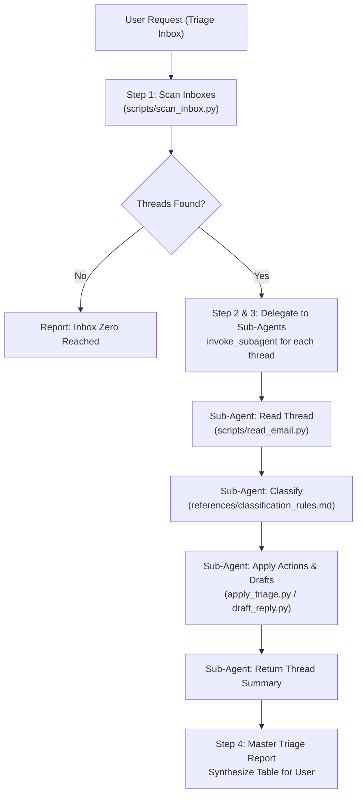

# Email Triage Skill

An autonomous, multi-account email triage system that organizes, classifies, and processes Gmail inboxes. It orchestrates a multi-agent workflow where an orchestrator agent discovers emails across accounts and delegates individual threads to specialized triage sub-agents.

> [!IMPORTANT]
> **Strict Tool Policy: No Direct Raw CLI Fallback**
> Under **NO circumstances** should an agent invoke raw `gog` CLI commands directly (e.g., `gog gmail ...`).
> All interactions with Gmail MUST be executed exclusively through the curated Python scripts located in:
> `./scripts/`
>
> This safeguards credentials, eliminates accidental bulk deletions or unexpected auto-sends, ensures proper character encoding, strips tracking/boilerplate noise, and standardizes multi-account handling.

---

## Architecture & Multi-Account Protocol

### Dynamic Account Discovery
The system avoids hardcoded accounts or aliases. It resolves accounts dynamically:
1. **Default Account Prioritization**: The default account is discovered via `gog auth status --json` (or the `GOG_ACCOUNT` environment variable) and is **always prioritized first**.
2. **Account Aliases**: Aliases configured in `gog` are queried via `gog auth alias list --json` (e.g. `work_account`, `personal_account`).
3. **Multi-Account Discovery**: All accounts with active Gmail access are detected via `gog auth list --json`.
4. **All-Accounts Scanning**: By default, `scan_inbox.py` iterates across all configured accounts in order (default account first). Every thread item is tagged with its owning `"account"`.

---

## Orchestrator Protocol

When a user requests an email triage or inbox sweep, the Orchestrator Agent executes this 4-step protocol:



### Step 1: Scan Inboxes
Run `./scripts/scan_inbox.py` across all accounts (or a specific account if explicitly requested by the user):
```bash
python3 ./scripts/scan_inbox.py --json
```
If specific query or limit is required:
```bash
python3 ./scripts/scan_inbox.py --query "is:unread in:inbox" --max 15 --json
```

### Step 2: Delegate Each Thread to an Isolated Sub-Agent
For each thread discovered, launch an independent sub-agent using `invoke_subagent`:
- **Role**: `Thread Triage Agent`
- **Prompt**: Follow the [Sub-Agent Prompt Template](#sub-agent-prompt-template) below, providing the `thread_id`, owning `account`, and subject snippet.

Running threads in isolated sub-agents ensures context window efficiency and eliminates cross-thread hallucination.

### Step 3: Thread Sub-Agent Workflow
Each sub-agent runs the following sequence:
1. **Read Classification Rules**: Consult [`references/classification_rules.md`](references/classification_rules.md) and [`references/actions_policy.md`](references/actions_policy.md).
2. **Fetch Thread Content**:
   ```bash
   python3 ./scripts/read_email.py <thread_id> --account <account> --json
   ```
3. **Classify**: Determine category:
   - `SPAM`: Unsolicited bulk marketing, phishing, unprompted vendor pitches.
   - `REGULAR`: Informational notifications, receipts, digests, low-urgency status updates.
   - `NEEDS_ATTENTION`: Direct requests from colleagues/clients, scheduled meetings, urgent blockers.
4. **Apply Triage Action**:
   - For `SPAM`:
     ```bash
     python3 ./scripts/apply_triage.py <thread_id> --account <account> --trash
     ```
   - For `REGULAR`:
     ```bash
     python3 ./scripts/apply_triage.py <thread_id> --account <account> --mark-read --archive
     ```
   - For `NEEDS_ATTENTION`:
     ```bash
     python3 ./scripts/apply_triage.py <thread_id> --account <account> --add-label "Triage/Action-Needed"
     ```
     If an immediate response is helpful, draft a proposed reply (never auto-send!):
     ```bash
     python3 ./scripts/draft_reply.py <message_id> --account <account> --body "Proposed draft text..."
     ```
5. **Return Structured Summary**: Communicate the result back to the orchestrator.

### Step 4: Synthesize Master Triage Report
Once all sub-agents finish, the orchestrator compiles and displays the **Master Triage Table**:

| Account | From | Subject | Category | Action Taken | Draft Created | Web Link |
| :--- | :--- | :--- | :--- | :--- | :--- | :--- |
| work_account | Alice `<alice@co.com>` | Architecture Review | `NEEDS_ATTENTION` | Labeled `Triage/Action-Needed` | Yes (Draft #1) | [Open](https://mail.google.com/...) |
| personal_account | Newsletter `<news@info.com>` | Weekly Digest | `REGULAR` | Marked read, Archived | No | [Open](https://mail.google.com/...) |
| work_account | Spammer `<promo@junk.io>` | Boost your leads | `SPAM` | Moved to Trash | No | [Open](https://mail.google.com/...) |

---

## Sub-Agent Prompt Template

When invoking sub-agents from the orchestrator, pass this exact template:

```markdown
You are a Thread Triage Agent for thread `{{THREAD_ID}}` on account `{{ACCOUNT}}`.

Your goal is to inspect, categorize, and triage this single email thread according to the project's email triage policy.

Mandatory Rules:
1. NEVER run raw `gog` commands directly. ONLY use scripts in `./scripts/`.
2. NEVER send emails. Only create drafts if a reply is warranted.
3. For spam, use `--trash` (safe delete to Gmail Trash). NEVER use `--delete` unless explicitly authorized with `--force`.

Steps to execute:
1. Fetch the thread details:
   python3 ./scripts/read_email.py {{THREAD_ID}} --account {{ACCOUNT}} --json
2. Review classification rules:
   Read `references/classification_rules.md` and `references/actions_policy.md`.
3. Categorize into SPAM, REGULAR, or NEEDS_ATTENTION.
4. Execute corresponding action using `./scripts/apply_triage.py` (pass `--account {{ACCOUNT}}`).
5. If NEEDS_ATTENTION and a reply is expected, draft a professional response using:
   python3 ./scripts/draft_reply.py <message_id> --account {{ACCOUNT}} --body "<draft_text>"
6. Send your final report back to the orchestrator with:
   - Account
   - Thread ID
   - Sender & Subject
   - Classification category & 1-sentence rationale
   - Actions taken (labels modified, archived, trashed, draft created)
   - Web link to thread
```

---

## Script Suite & Flag Reference

All scripts support `-h` / `--help` and reside in `./scripts/`.

### 1. `scan_inbox.py`
Scans Gmail inboxes for matching threads across all accounts or a designated account.

| Flag | Short | Default | Description |
| :--- | :--- | :--- | :--- |
| `--query` | `-q` | `is:unread in:inbox` | Gmail search query |
| `--max` | `-m` | `10` | Maximum number of threads per account |
| `--account` | `-a` | All accounts | Specific account alias/email (omit to scan all) |
| `--json` | `-j` | `False` | Structured JSON output |

### 2. `read_email.py`
Reads and decodes an entire email thread, stripping HTML noise, tracking pixels, and boilerplates.

| Flag | Short | Default | Description |
| :--- | :--- | :--- | :--- |
| `thread_id` | | *(Required)* | Gmail Thread ID to read |
| `--account` | `-a` | Default account | Specific account alias or email |
| `--json` | `-j` | `False` | Structured JSON output |

### 3. `apply_triage.py`
Applies label modifications, read status, archiving, or trashing to one or more threads.

| Flag | Short | Default | Description |
| :--- | :--- | :--- | :--- |
| `thread_ids` | | *(Required)* | One or more thread IDs |
| `--mark-read` | `-r` | `False` | Remove `UNREAD` label |
| `--archive` | | `False` | Remove `INBOX` label |
| `--trash` | `-t` | `False` | Move thread to Gmail Trash (safe deletion) |
| `--delete` | | `False` | Permanently delete thread (requires `--force`) |
| `--force` | `-f` | `False` | Confirmation required for permanent deletion |
| `--add-label` | | `None` | One or more labels to add |
| `--remove-label` | | `None` | One or more labels to remove |
| `--dry-run` | `-n` | `False` | Simulate action without modifying Gmail |
| `--account` | `-a` | Default account | Specific account alias or email |
| `--json` | `-j` | `False` | Structured JSON output |

### 4. `draft_reply.py`
Safely creates a draft reply in Gmail (never sends automatically).

| Flag | Short | Default | Description |
| :--- | :--- | :--- | :--- |
| `message_id` | | *(Required)* | Message ID to reply to |
| `--body` | `-b` | `None` | Reply text content |
| `--body-file` | `-F` | `None` | File path containing reply text |
| `--reply-all` | `-R` | `False` | Reply to all recipients |
| `--dry-run` | `-n` | `False` | Preview draft without creating in Gmail |
| `--account` | `-a` | Default account | Specific account alias or email |
| `--json` | `-j` | `False` | Structured JSON output |

### 5. `manage_labels.py`
Inspects existing labels and sets up standard triage labels idempotently.

| Flag | Short | Default | Description |
| :--- | :--- | :--- | :--- |
| `--list` | `-l` | `False` | List all labels in the mailbox (default action) |
| `--setup` | `-s` | `False` | Ensure `Triage/Action-Needed`, `Triage/Waiting`, `Triage/FYI` exist |
| `--dry-run` | `-n` | `False` | Simulate setup without creating labels |
| `--account` | `-a` | Default account | Specific account alias or email |
| `--json` | `-j` | `False` | Structured JSON output |

---

## Safety Guarantees & Policies

1. **No Accidental Send**: There is no script to send emails. Only draft creation (`draft_reply.py`) is provided.
2. **Safe Deletion**: Unwanted or spam messages are moved to Trash via `--trash`. Permanent deletion (`--delete`) requires explicit `--force`.
3. **Simulation via Dry-Run**: All mutating scripts support `--dry-run` (`-n`) to preview actions safely.
4. **Clean Content Extraction**: Text extraction strips tracking web bugs (1x1 pixels), CSS styling, script tags, and disclaimers, protecting token context from inflation.
