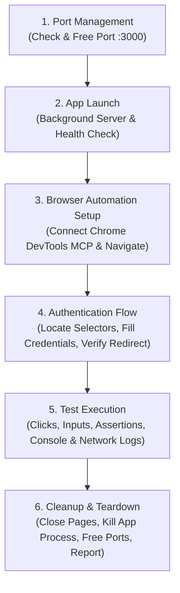

# Manual Browser Automation

A specialized agent skill for automated and manual end-to-end browser testing using the [Chrome DevTools MCP (Model Context Protocol) Server](https://github.com/modelcontextprotocol/servers/tree/main/src/chrome-devtools). This skill governs the entire testing lifecycle: port collision detection and resolution, background application startup, headless/headed browser connection, authentication workflows, visual and behavioral assertion testing, and clean resource teardown.

---

## Table of Contents

- [Overview & Philosophy](#overview--philosophy)
- [When to Use](#when-to-use)
- [Workflow Architecture](#workflow-architecture)
- [Required Dependencies & Installation](#required-dependencies--installation)
- [Usage & Examples](#usage--examples)
  - [Agent Invocation](#agent-invocation)
  - [MCP Tool Reference](#mcp-tool-reference)
  - [Example End-to-End Test Workflow](#example-end-to-end-test-workflow)
- [Error Handling & Edge Cases](#error-handling--edge-cases)
- [File Structure](#file-structure)

---

## Overview & Philosophy

Modern web applications present complex runtime behaviors—asynchronous data fetching, dynamic single-page routing, client-side state hydration, and authentication cookies—that static analysis and isolated unit tests cannot verify.

The **Manual Browser Automation** skill bridges the gap between AI development agents and real browser runtime environments. It operates under four core principles:

1. **Deterministic Lifecycle Management**: Always guarantee that ports are available before launching servers, verify health endpoints before connecting browsers, and terminate child processes cleanly upon test completion.
2. **Visual & Behavioral Evidence**: Never assume an action succeeded solely based on a 200 HTTP code. Take screenshots, capture DOM snapshots, monitor JavaScript console logs, and assert visible UI state changes.
3. **Resilience Over Arbitrary Timeouts**: Favor explicit readiness checks (`wait_for` elements, network idle detection) over static `sleep` calls.
4. **Non-Destructive Execution**: Isolate test runs, use dedicated test credentials or sandboxed databases, and revert working trees or session state during teardown.

---

## When to Use

### Recommended Scenarios
- **End-to-End User Verification**: Testing critical user journeys such as user signup, authentication, checkout flows, and dashboard navigation.
- **Visual Regression & UI Inspection**: Capturing screenshots across viewports to verify styling, layout responsiveness, and element positioning.
- **Client-Side Diagnostics**: Inspecting browser console errors, failed network requests, CORS misconfigurations, or unhandled exceptions.
- **Interactive Form Validation**: Validating complex form constraints, dynamic field validation, file uploads, and modal dialog interactions.
- **Pre-Merge Smoke Testing**: Running sanity smoke checks against a newly built feature before opening a pull request.

### When NOT to Use
- Pure unit tests of isolated algorithms, utilities, or backend services (use unit test runners like Jest, Vitest, or pytest instead).
- Headless API contract testing (prefer curl, fetch, or dedicated integration test suites).

---

## Workflow Architecture

The lifecycle follows a structured 6-stage execution pipeline:



### Execution Stages

1. **Port Management**: Detects whether the target port (default `3000`) is in use using `lsof`. If occupied, terminates the blocking process cleanly or negotiates an alternative port.
2. **Application Launch**: Starts the local dev or preview server as a detached background process, streaming output to monitor readiness logs before progressing.
3. **Browser Automation Setup**: Connects via Chrome DevTools MCP, initializes a new page context, loads the URL, and captures a baseline screenshot.
4. **Authentication Flow**: Populates login fields, submits credentials, monitors redirect headers, and verifies authenticated cookies or session tokens.
5. **Testing Execution**: Executes user actions (`click`, `type_text`, `fill_form`), validates DOM mutations with `evaluate_script`, tracks network latency, and inspects console warnings/errors.
6. **Cleanup**: Closes all browser targets, terminates background processes, and outputs a structured Markdown test report with visual evidence.

---

## Required Dependencies & Installation

To run browser automation via this skill, ensure the following prerequisites are installed on your host system:

| Dependency | Purpose | Minimum Version | Installation Link |
|------------|---------|-----------------|-------------------|
| **Google Chrome** | Chromium browser runtime for DevTools automation | Latest Stable | [Download Chrome](https://www.google.com/chrome/) |
| **Node.js & npm** | JavaScript runtime required for the MCP DevTools server | Node.js v18+ | [Download Node.js](https://nodejs.org/) |
| **Chrome DevTools MCP** | Model Context Protocol server exposing browser control | Latest | [GitHub Repository](https://github.com/modelcontextprotocol/servers/tree/main/src/chrome-devtools) |
| **lsof / fuser** | Unix utility for port conflict detection | Built-in / OS default | Standard Unix package (`iproute2` / `lsof`) |

### Command-Line Installation

#### 1. Install Google Chrome (macOS / Linux)
```bash
# macOS (via Homebrew)
brew install --cask google-chrome

# Ubuntu / Debian
wget https://dl.google.com/linux/direct/google-chrome-stable_current_amd64.deb
sudo dpkg -i google-chrome-stable_current_amd64.deb
sudo apt-get install -f
```

#### 2. Install Node.js & npm
```bash
# macOS (via Homebrew)
brew install node

# Ubuntu / Debian (via NodeSource)
curl -fsSL https://deb.nodesource.com/setup_20.x | sudo -E bash -
sudo apt-get install -y nodejs
```

#### 3. Configure Chrome DevTools MCP Server
Add the Chrome DevTools MCP server configuration to your MCP settings file (e.g., `~/.gemini/antigravity/mcp_config.json` or Claude Desktop configuration):

```json
{
  "mcpServers": {
    "chrome-devtools": {
      "command": "npx",
      "args": ["-y", "@modelcontextprotocol/server-chrome-devtools"]
    }
  }
}
```

#### 4. Verify Port Inspection Tool
```bash
# Verify lsof is available
which lsof || sudo apt-get install lsof
```

---

## Usage & Examples

### Agent Invocation

An AI coding agent invokes this skill whenever a user requests manual testing, UI verification, or bug reproduction involving browser behavior:

```text
User: "Please verify that the new user profile editing page works on localhost:3000. Test updating the user's bio and avatar."
```

### MCP Tool Reference

The skill interacts with the browser exclusively through lazy-loaded or native Chrome DevTools MCP tools:

| Category | Tool Names | Common Use Case |
|----------|------------|-----------------|
| **Navigation** | `navigate_page`, `new_page`, `close_page`, `list_pages`, `wait_for` | Moving between routes, waiting for dynamic DOM changes |
| **Interaction** | `click`, `type_text`, `fill`, `fill_form`, `hover`, `press_key`, `drag`, `upload_file` | Typing into inputs, clicking buttons, submitting forms |
| **Inspection** | `take_screenshot`, `take_snapshot`, `evaluate_script` | Taking visual proofs, evaluating DOM properties |
| **Diagnostics** | `list_console_messages`, `get_console_message`, `list_network_requests` | Checking for JS errors or API 4xx/5xx responses |
| **Audit** | `lighthouse_audit`, `performance_start_trace` | Measuring Core Web Vitals and accessibility score |

### Example End-to-End Test Workflow

Here is how an agent executes a typical login and dashboard test:

#### Step 1: Manage Port & Start Application
```bash
# Check if port 3000 is open
lsof -i :3000

# If a stale process exists, terminate it gracefully:
kill -15 <PID> || kill -9 <PID>

# Start application in background
npm run dev -- --port 3000 &
```

#### Step 2: Navigate and Verify Login Form
The agent invokes DevTools MCP tools:
```json
// Navigate to the local application
{
  "ServerName": "chrome-devtools",
  "ToolName": "navigate_page",
  "Arguments": { "url": "http://localhost:3000/login" }
}

// Wait for form input to render
{
  "ServerName": "chrome-devtools",
  "ToolName": "wait_for",
  "Arguments": { "selector": "input[name='email']" }
}

// Fill in credentials and submit
{
  "ServerName": "chrome-devtools",
  "ToolName": "fill",
  "Arguments": { "selector": "input[name='email']", "value": "testuser@example.com" }
}
{
  "ServerName": "chrome-devtools",
  "ToolName": "fill",
  "Arguments": { "selector": "input[name='password']", "value": "SecretPassword123" }
}
{
  "ServerName": "chrome-devtools",
  "ToolName": "click",
  "Arguments": { "selector": "button[type='submit']" }
}
```

#### Step 3: Assert Redirect and Capture Evidence
```json
// Wait for dashboard heading
{
  "ServerName": "chrome-devtools",
  "ToolName": "wait_for",
  "Arguments": { "selector": "h1#dashboard-welcome" }
}

// Capture screenshot for test verification
{
  "ServerName": "chrome-devtools",
  "ToolName": "take_screenshot",
  "Arguments": { "filePath": "artifacts/dashboard-success.png" }
}

// Check for console errors
{
  "ServerName": "chrome-devtools",
  "ToolName": "list_console_messages",
  "Arguments": { "types": ["error"] }
}
```

---

## Error Handling & Edge Cases

- **Port in Use**: If port 3000 cannot be freed, the skill automatically detects the collision, warns the user, and configures the development server to run on an alternative available port (e.g., `3001` or `8080`).
- **Selector Timeout**: When `wait_for` fails, capture an immediate screenshot and dump the DOM snapshot using `take_snapshot` to inspect whether a modal, error alert, or loading skeleton blocked the expected element.
- **Authentication Failures (2FA / CAPTCHA)**: If automated authentication fails due to CAPTCHA or external OAuth 2FA barriers, pause automation, explain the blocker clearly to the user, and request human intervention or test tokens.
- **Process Cleanup**: Ensure trap handlers or final test hooks terminate any spawned development servers and free system resources even if the test fails prematurely.

---

## File Structure

```text
manual-automation/
├── SKILL.md       # Core skill instructions and operational guidelines
└── README.md      # Comprehensive technical overview, setup, and usage guide
```

- [SKILL.md](./SKILL.md): The authoritative operational instruction file read by AI agents during skill activation. Contains step-by-step procedures, exit criteria, and tool references.
