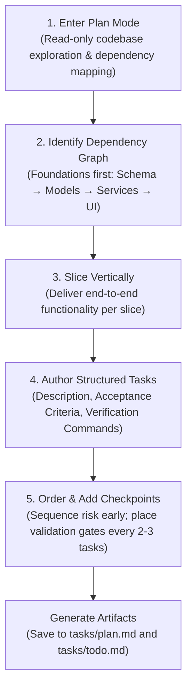

# Planning and Task Breakdown

A structured software engineering skill for decomposing complex technical specifications, feature requests, and refactoring initiatives into small, vertically sliced, and independently verifiable tasks. It prevents the common failure mode of unguided agent execution by producing concrete implementation plans (`tasks/plan.md`) and actionable checklists (`tasks/todo.md`) before any code is written.

---

## Table of Contents

- [Overview & Philosophy](#overview--philosophy)
- [When to Use](#when-to-use)
- [Workflow Architecture](#workflow-architecture)
- [Required Dependencies & Installation](#required-dependencies--installation)
- [Usage & Examples](#usage--examples)
  - [The 5-Step Planning Process](#the-5-step-planning-process)
  - [Task Specification Standard](#task-specification-standard)
  - [Task Sizing Matrix](#task-sizing-matrix)
  - [Plan Document Template](#plan-document-template)
- [File Structure](#file-structure)

---

## Overview & Philosophy

The difference between an AI agent that delivers robust software and one that produces fragmented, untestable code is the quality of its task breakdown.

The **Planning and Task Breakdown** skill enforces rigorous engineering discipline through three core tenets:

1. **"Planning is the Task"**: Implementation without a validated plan is merely speculative typing. Operates in strict read-only mode during planning—no code changes until the design and sequence are approved.
2. **Vertical Slices Over Horizontal Layers**: Horizontal breakdown (e.g., "Build all DB schemas", then "Build all API endpoints", then "Build UI") delays end-to-end feedback until the end. Vertical slicing builds one complete user journey across all layers per task, delivering immediate verifiable value.
3. **Fail Fast with Early Checkpoints**: High-risk tasks and core architectural dependencies are prioritized upfront. Explicit checkpoints after every 2–3 tasks guarantee system health and test passing before proceeding.
4. **Context-Window Friendly Sizing**: Tasks sized larger than 3–5 files overwhelm context windows and lead to hallucinations. Tasks are intentionally kept to Small (S) or Medium (M) boundaries.

---

## When to Use

### Recommended Scenarios
- **Non-Trivial Feature Implementation**: Developing new features spanning multiple files, packages, or architectural layers.
- **Large Refactoring Initiatives**: Migrating dependencies, updating data models, or refactoring shared APIs without breaking existing consumers.
- **Ambiguous or Broad Specifications**: When a user request feels too broad, risky, or underspecified to start coding immediately.
- **Multi-Agent Orchestration**: Preparing ordered work for coordinated multi-agent systems (e.g., `agent-loop`).
- **Human-in-the-Loop Alignment**: When explicit approval from a human engineer or team lead is needed before code is altered.

### When NOT to Use
- **Single-File Fixes**: Small bug fixes, localized typo corrections, or minor documentation tweaks where the scope is self-evident.
- **Pre-Decomposed Specifications**: When the user has already provided an exact, step-by-step checklist of granular tasks.

---

## Workflow Architecture

The breakdown process transitions through five structured phases:



### Process Overview

- **Step 1: Plan Mode**: Examine the codebase, inspect relevant imports, existing patterns, and test suites. Do not touch or create application code.
- **Step 2: Dependency Graph Mapping**: Establish bottom-up technical foundations (e.g., database migrations must precede API models, which precede service endpoints).
- **Step 3: Vertical Slicing**: Reorganize horizontal work into thin, full-stack vertical slices where each task produces observable, testable functionality.
- **Step 4: Task Definition**: Specify exact files touched, acceptance criteria (checkboxes), and automated shell commands to verify completion.
- **Step 5: Ordering & Checkpoints**: Introduce explicit checkpoint stops to run the full build and test suite, ensuring no regressions accumulate.

---

## Required Dependencies & Installation

This skill requires version control tools to track branch state, along with standard runtime environments and test runners for executing verification commands:

| Dependency | Purpose | Minimum Version | Installation Link |
|------------|---------|-----------------|-------------------|
| **Git** | Version control for tracking diffs, commits, and rollback points | v2.20+ | [Download Git](https://git-scm.com/) |
| **Node.js & npm** | JavaScript/TypeScript runtime and test execution | v18+ | [Download Node.js](https://nodejs.org/) |
| **Python** *(optional)* | Python runtime and pytest runner for Python-based projects | v3.9+ | [Download Python](https://www.python.org/) |
| **Markdown Tools** | Text editor or CLI for viewing and editing markdown plans | Any | [VS Code](https://code.visualstudio.com/) / [Obsidian](https://obsidian.md/) |

### Command-Line Installation

#### 1. Install Git
```bash
# macOS (via Homebrew)
brew install git

# Ubuntu / Debian
sudo apt-get update && sudo apt-get install -y git
```

#### 2. Install Node.js & Package Managers
```bash
# macOS (via Homebrew)
brew install node pnpm

# Ubuntu / Debian (via NodeSource)
curl -fsSL https://deb.nodesource.com/setup_20.x | sudo -E bash -
sudo apt-get install -y nodejs
```

#### 3. Install Python & Pytest (if testing Python codebases)
```bash
# macOS (via Homebrew)
brew install python

# Ubuntu / Debian
sudo apt-get install -y python3 python3-pip python3-venv

# Install pytest
pip install pytest
```

---

## Usage & Examples

### The 5-Step Planning Process

When instructed to plan a feature, the agent activates this skill and follows these operational phases:

1. **Activate Read-Only Mode**: Do not edit source code.
2. **Explore Existing Conventions**: Read project documentation, configuration files, and related implementations.
3. **Draft the Plan**: Generate a structured plan document at `tasks/plan.md`.
4. **Draft the Task List**: Generate an actionable checklist at `tasks/todo.md`.
5. **Seek Approval**: Request human review and approval before beginning execution.

---

### Task Specification Standard

Every task generated by this skill adheres to the following specification format:

```markdown
## Task 2: Implement User Registration Endpoint

**Description:** Add POST `/api/v1/auth/register` to handle new user registration with input validation, password hashing, and database persistence.

**Acceptance criteria:**
- [ ] Validates email format and password strength (min 8 chars, 1 number).
- [ ] Hashes password using argon2 before persistence.
- [ ] Returns HTTP 201 with sanitized user payload (no password hash).
- [ ] Returns HTTP 409 Conflict if email is already registered.

**Verification:**
- [ ] Tests pass: `npm test -- --grep "POST /api/v1/auth/register"`
- [ ] Type check succeeds: `npm run typecheck`
- [ ] Linter clean: `npm run lint`

**Dependencies:** Task 1 (Database schema and migrations)

**Files likely touched:**
- `src/controllers/auth.controller.ts`
- `src/services/auth.service.ts`
- `src/validators/auth.validator.ts`
- `tests/integration/auth.test.ts`

**Estimated scope:** Medium (4 files)
```

---

### Task Sizing Matrix

To prevent agent degradation, each task must be classified according to the following sizing guidelines:

| Size | Files | Scope Description | Action |
|------|:-----:|-------------------|--------|
| **XS** | 1 | Single utility function, typo, or configuration change | Ideal for rapid execution |
| **S** | 1–2 | One isolated component, helper, or single route | Preferred agent target |
| **M** | 3–5 | One end-to-end vertical feature slice with tests | Standard maximum task size |
| **L** | 5–8 | Multi-subsystem change | **Warning**: Break down into smaller S/M tasks |
| **XL** | 8+ | Architectural overhaul or broad refactor | **Prohibited**: Must be decomposed |

> [!TIP]
> If a task title contains the word "and" (e.g., "Build login endpoint **and** add profile settings page"), it is almost certainly two separate tasks.

---

### Plan Document Template

The skill standardizes plan generation in `tasks/plan.md`:

```markdown
# Implementation Plan: [Feature/Project Name]

## Overview
[One-paragraph summary of what is being built and why]

## Architecture Decisions
- [Key decision 1 and rationale]
- [Key decision 2 and rationale]

## Task Breakdown

### Phase 1: Foundation
- [ ] Task 1: [Title]
- [ ] Task 2: [Title]

### Checkpoint: Foundation
- [ ] All unit tests pass (`npm test`)
- [ ] Clean build (`npm run build`)

### Phase 2: Core Vertical Slices
- [ ] Task 3: [Title]
- [ ] Task 4: [Title]

### Checkpoint: Integration Verification
- [ ] End-to-end integration flow verified
- [ ] Human review of progress

### Phase 3: Final Polish & Documentation
- [ ] Task 5: [Title]

## Risks and Mitigations
| Risk | Impact | Mitigation Strategy |
|------|:------:|---------------------|
| [Potential risk] | High / Med / Low | [Mitigation] |

## Open Questions
- [Unresolved question requiring human input]
```

---

## File Structure

```text
planning-and-task-breakdown/
├── SKILL.md       # Core skill instructions, task rules, and heuristics
└── README.md      # Comprehensive engineering guide and documentation
```

- [SKILL.md](./SKILL.md): The core instruction file providing prompt guidelines, sizing constraints, anti-pattern warnings, and the plan template.
