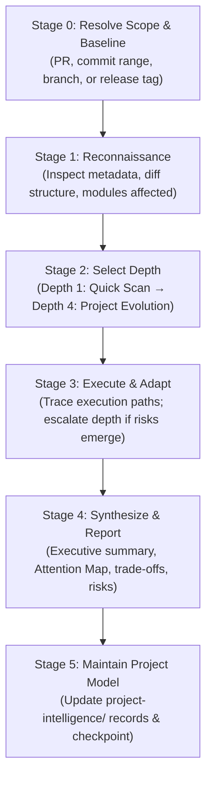

# Project Change Intelligence

An advanced engineering intelligence skill that acts as a senior software architect, code reviewer, and technical project historian. It enables project owners, engineering leads, and developers to understand how a codebase is evolving without manually inspecting every line of Git diffs or pull requests.

---

## Table of Contents

- [Overview & Philosophy](#overview--philosophy)
- [When to Use](#when-to-use)
- [Workflow Architecture](#workflow-architecture)
- [Progressive Investigation Depths](#progressive-investigation-depths)
- [PR/MR Review Mode & Guided Code Reading](#prmr-review-mode--guided-code-reading)
- [Multi-Subagent Coordination](#multi-subagent-coordination)
- [Required Dependencies & Installation](#required-dependencies--installation)
- [Usage & Examples](#usage--examples)
  - [Example Prompts](#example-prompts)
  - [Sample "Code Worth Your Attention" Block](#sample-code-worth-your-attention-block)
  - [Sample Report Structure](#sample-report-structure)
- [Persistent Project Knowledge](#persistent-project-knowledge)
- [File Structure](#file-structure)

---

## Overview & Philosophy

As codebases grow and development velocity accelerates, human developers and engineering leads face context starvation. Reading raw diffs line-by-line is time-consuming, and superficial summaries fail to reveal hidden breaking changes, data consistency risks, or architectural drift.

The **Project Change Intelligence** skill provides deep, evidence-backed comprehension through these core principles:

1. **Evidence First**: Every conclusion must be grounded directly in commit history, diffs, test files, or configuration. Never fabricate intent or guess rationale.
2. **Analyze Behavior, Not Syntax**: Focus on execution paths, state transitions, API contracts, failure modes, and observable consequences rather than cosmetic syntax changes.
3. **Prioritize Significance**: A 3-line security or data-integrity patch often matters far more than an 800-line whitespace or refactoring change.
4. **Investigate Progressively**: Start with a lightweight reconnaissance scan, deepen analysis only when risk or complexity warrants it, and stop once the decision criteria are met.
5. **Read-Only by Default**: Operate strictly as an analytical observer—no arbitrary file mutations or unprompted branch commits.
6. **Separate Facts from Interpretations**: Distinctly label proven facts, potential risks, design trade-offs, and unknowns.

---

## When to Use

### Recommended Scenarios
- **Pull Request / Merge Request Reviews**: Conducting high-confidence PR reviews with a "Guided Code Reading" attention map that highlights the exact lines that matter.
- **Catch-Up & Onboarding**: Summarizing what changed over the last *N* commits, sprint, or release (e.g., "Bring me up to speed on what changed this week").
- **Release Auditing & Risk Assessment**: Evaluating the operational and security risks of a pending release tag or production deployment.
- **Architectural Drift Detection**: Spotting violations of established system boundaries, circular dependencies, or leaking abstractions.
- **Historical Rationale Reconstruction**: Uncovering why a legacy component was implemented a certain way and whether new PRs violate historical invariants.

---

## Workflow Architecture

The skill employs an adaptive 5-stage progressive pipeline:



---

## Progressive Investigation Depths

Rather than performing expensive deep analysis on trivial changes, the skill dynamically selects the lowest sufficient depth and escalates when warranted:

| Depth Level | Target Use Case | Investigation Focus | Delegation |
|-------------|-----------------|---------------------|------------|
| **Depth 1: Quick Scan** | Small, localized bug fixes or config updates | Stated intent, diff summary, obvious regression risks | Single agent (no subagents) |
| **Depth 2: Focused Analysis** | Multi-file features, internal refactors | Before/after behavior, caller chains, test coverage | Primary agent (optional subagent) |
| **Depth 3: Deep Investigation** | Cross-boundary changes, API contract changes | Data flows, migration safety, failure recovery, security | Multi-subagent parallel investigation |
| **Depth 4: Project-Level** | Milestone catch-up, release auditing, evolution | Subsystem evolution, architectural drift, design trade-offs | Coordinated subagent team |

---

## PR/MR Review Mode & Guided Code Reading

When analyzing a Pull Request or Merge Request, the skill produces a **Guided Code Reading** experience to help the reviewer navigate the code efficiently:

1. **Logical Reading Order**: Presents code in execution flow order (`Entry Point → Validation → Business Logic → Persistence → Response`), rather than alphabetical file order.
2. **Attention Map**: Isolates the critical 5–10 locations in the diff that define the change.
3. **Comprehension vs. Defect Distinction**: Clearly distinguishes between "understand how this works" and "potential defect to investigate".

---

## Multi-Subagent Coordination

For complex PRs (Depths 3 & 4), the skill can delegate bounded investigations to specialized subagents:

- **Implementation Investigator**: Traces caller chains, execution paths, and before/after behavior.
- **Architecture Investigator**: Evaluates component boundaries, coupling, and system invariants.
- **Risk Investigator**: Inspects concurrency, authentication, error recovery, and data integrity.
- **Testing Investigator**: Evaluates test quality, edge cases, and missing test assertions.
- **Historical Investigator**: Explores git history, past PR discussions, and superseded assumptions.

The primary agent coordinates the team, verifies all claims against the repository, and synthesizes one coherent report.

---

## Required Dependencies & Installation

To run project change intelligence analyses, ensure the following version control and platform CLI tools are installed:

| Dependency | Purpose | Minimum Version | Installation Link |
|------------|---------|-----------------|-------------------|
| **Git** | Core version control system for diffs, log histories, and tree inspection | v2.28+ | [Download Git](https://git-scm.com/) |
| **GitHub CLI (`gh`)** | Fetches PR metadata, diffs, comments, and CI check runs from GitHub | v2.20+ | [Download GitHub CLI](https://cli.github.com/) |
| **GitLab CLI (`glab`)** *(optional)* | Inspects Merge Requests and pipelines for GitLab repositories | v1.25+ | [Download GitLab CLI](https://gitlab.com/gitlab-org/cli) |

### Command-Line Installation

#### 1. Install Git
```bash
# macOS (via Homebrew)
brew install git

# Ubuntu / Debian
sudo apt-get update && sudo apt-get install -y git
```

#### 2. Install GitHub CLI (`gh`)
```bash
# macOS (via Homebrew)
brew install gh

# Ubuntu / Debian
type -p curl >/dev/null || sudo apt install curl -y
curl -fsSL https://cli.github.com/packages/githubcli-archive-keyring.gpg | sudo dd of=/usr/share/keyrings/githubcli-archive-keyring.gpg
sudo chmod go+r /usr/share/keyrings/githubcli-archive-keyring.gpg
echo "deb [arch=$(dpkg --print-architecture) signed-by=/usr/share/keyrings/githubcli-archive-keyring.gpg] https://cli.github.com/packages stable main" | sudo tee /etc/apt/sources.list.d/github-cli.list > /dev/null
sudo apt update
sudo apt install gh -y
```

#### 3. Authenticate GitHub CLI
```bash
gh auth login
```

---

## Usage & Examples

### Example Prompts

An agent or developer activates this skill using prompts such as:
- *"Analyze PR #42 with guided code reading."*
- *"What changed across the last 15 commits on the main branch?"*
- *"Bring me up to speed on the architectural changes made this past month."*
- *"Audit the breaking changes and deployment risks in release tag v2.4.0."*

---

### Sample "Code Worth Your Attention" Block

When reviewing a PR, the skill outputs structured attention items:

```markdown
### Code Worth Your Attention

#### [High] Payment Transaction Atomicity
`src/payments/payment-service.ts:84–112`
- **Symbol:** `PaymentService.processPayment()`
- **What it does:** Coordinates payment intent creation, ledger updates, and external Stripe API invocation.
- **Why it matters:** The external provider is called inside an active database transaction. A network timeout could hold database locks or cause duplicate charges on retry.
- **What to inspect:** Idempotency key handling and moving the external network call outside the database transaction boundary.
- **Evidence:** See `src/payments/payment-service.ts#L96` and `tests/payments/stripe.test.ts#L45`.
```

---

### Sample Report Structure

For comprehensive investigations, reports follow this structured format:

1. **Executive Summary**: High-level impact and analyzed revision range.
2. **What Changed**: Grouped changes with before-and-after operational context.
3. **Code Worth Your Attention**: Prioritized attention map with file links and symbols.
4. **Architecture & System Behavior**: Data flows, component boundaries, and schema shifts.
5. **Decisions & Trade-Offs**: Why choices were made, accepted compromises, and constraints.
6. **Risks & Verification Gaps**: Confirmed issues, potential risks, and untested edge cases.
7. **Implications for Project Owner**: Key takeaways for maintaining project control.
8. **Recommended Follow-Ups**: Up to 5 prioritized, concrete next steps.

---

## Persistent Project Knowledge

To avoid redundant re-analysis across sessions, the skill can maintain a lightweight knowledge store in `project-intelligence/`:

```text
project-intelligence/
├── OVERVIEW.md       # High-level system architecture and critical data flows
├── DECISIONS.md      # Architectural decisions, rationale, and accepted trade-offs
├── CHANGELOG.md      # Significant changes grouped by feature and subsystem
├── OPEN-QUESTIONS.md # Unresolved questions, assumptions, and known risks
└── CHECKPOINT.md     # Last successfully analyzed Git commit SHA and timestamp
```

---

## File Structure

```text
project-change-intelligence/
├── SKILL.md       # Complete 680+ line operational specification and heuristics
└── README.md      # Comprehensive engineering guide and reference documentation
```

- [SKILL.md](./SKILL.md): The core instruction file specifying the progressive investigation stages, PR review attention mapping, subagent delegation contracts, and quality criteria.
