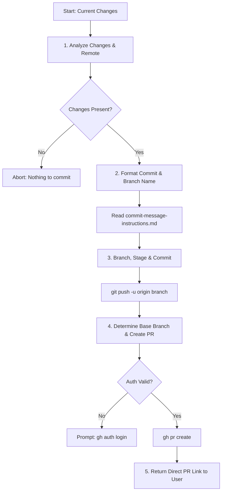

# Pull Request Automation Skill (`pull-request`)

A standardized, automated Git and GitHub workflow skill that turns local uncommitted or staged changes into published GitHub Pull Requests using the GitHub CLI (`gh`).

---

## Overview

The `pull-request` skill enables AI agents and developers to reliably package local code modifications into clean, review-ready GitHub Pull Requests. It eliminates manual branch management, automates Conventional Commit generation, identifies upstream base branches dynamically, and publishes PRs with structured descriptions and impact analyses.

### Core Philosophy

1. **Standardized Commit Quality**: Commits must strictly adhere to the Conventional Commits specification, utilizing structured headers, explanatory bodies, and explicit impact analyses (breaking changes, configuration updates, migrations).
2. **Deterministic & Non-Destructive**: Inspects repository state before modifying branches or staging files.
3. **Graceful Authentication Handling**: Validates `gh` CLI credentials and instructs the user when session refresh or login is required.
4. **Seamless Hand-Off**: Concludes by presenting the direct GitHub URL for immediate review.

### When to Use

- When local development, bug fixes, or refactoring tasks are complete and ready for pull request submission.
- When an AI agent needs to autonomously create a feature branch, commit with consistent style, and request code review.
- When you want to eliminate repetitive terminal commands (`git checkout -b`, `git add`, `git commit`, `git push`, `gh pr create`).

---

## Workflow & Architecture

The skill follows a structured 5-stage lifecycle:



### Detailed Execution Breakdown

1. **Analyze Current Changes**:
   - Inspect status and diffs via `git status`, `git diff`, and `git diff --staged`.
   - Identify repository origin with `git remote -v`.
   - Evaluate scope, affected modules, and primary intent (feature, fix, chore, docs, refactor).
2. **Synthesize Commit & Branch Name**:
   - Read and apply the guidelines in [commit-message-instructions.md](./commit-message-instructions.md).
   - Generate a concise kebab-case branch name (e.g., `feat/auth-rate-limiting` or `fix/jwt-expiration`).
   - Draft a compliant Conventional Commit message (Header <= 72 chars, imperative mood, explanatory body, impact analysis, ticket references).
3. **Branch, Stage, and Push**:
   - Checkout a new feature branch: `git checkout -b <branch-name>`
   - Stage modified and new files: `git add .`
   - Commit changes: `git commit -m "<formatted-commit-message>"`
   - Push to origin tracking branch: `git push -u origin <branch-name>`
4. **Create GitHub Pull Request**:
   - Dynamically identify the default target branch (e.g., via `git symbolic-ref refs/remotes/origin/HEAD` or `git remote show origin`).
   - Create PR using GitHub CLI: `gh pr create --title "<title>" --body "<body>" --base <target-branch>`
5. **Report Result**:
   - Surface the live GitHub PR URL to the user or calling agent.

---

## Required Dependencies & Installation Links

To run this skill, both **Git** and the **GitHub CLI (`gh`)** must be installed and authenticated on the host system.

| Tool | Minimum Version | Description | Installation Link |
| :--- | :--- | :--- | :--- |
| **Git** | `2.20+` | Core distributed version control system | [git-scm.com/downloads](https://git-scm.com/downloads) |
| **GitHub CLI (`gh`)** | `2.0+` | Official command-line client for GitHub | [cli.github.com](https://cli.github.com/) |

### Command-Line Installation

#### macOS (via Homebrew)
```bash
brew install git gh
```

#### Debian / Ubuntu Linux
```bash
# Install Git
sudo apt-get update && sudo apt-get install -y git

# Install GitHub CLI (official repository)
(type -p wget >/dev/null || (sudo apt update && sudo apt-get install wget -y)) \
  && sudo mkdir -p -m 755 /etc/apt/keyrings \
  && wget -qO- https://cli.github.com/packages/githubcli-archive-keyring.gpg | sudo tee /etc/apt/keyrings/githubcli-archive-keyring.gpg > /dev/null \
  && sudo chmod go+r /etc/apt/keyrings/githubcli-archive-keyring.gpg \
  && echo "deb [arch=$(dpkg --print-architecture) signed-by=/etc/apt/keyrings/githubcli-archive-keyring.gpg] https://cli.github.com/packages stable main" | sudo tee /etc/apt/sources.list.d/github-cli.list > /dev/null \
  && sudo apt update \
  && sudo apt install gh -y
```

#### Windows (via winget or Scoop)
```powershell
# Using WinGet
winget install --id Git.Git -e --source winget
winget install --id GitHub.cli -e --source winget

# Using Scoop
scoop install git gh
```

### Initial GitHub CLI Authentication

Verify that `gh` is authenticated to your GitHub account:

```bash
# Check existing authentication status
gh auth status

# Interactive login (if not logged in)
gh auth login
```

---

## Usage & Examples

### Invoking via AI Agent

When interacting with an AI assistant that has the `pull-request` skill enabled, request:

```text
"Please create a feature branch, commit my current changes, and open a GitHub PR."
```

Or trigger with specific context:

```text
"Package the current changes into a PR targeting main. Fixes ticket #456."
```

### Manual Execution Example

If executing the sequence manually or embedding into a custom automation script:

```bash
# 1. Check current status
git status

# 2. Create feature branch and stage files
git checkout -b feat/login-rate-limiting
git add .

# 3. Commit with structured Conventional Commit format
git commit -m "feat(auth): Add login rate limiting

This change implements rate limiting on the login endpoint to prevent brute
force attacks. Users are locked out after 5 consecutive failed attempts.

Impact:
- Configuration: Added SECURITY_MAX_ATTEMPTS to config.yaml
- Security: Enforces 5-attempt limit per client IP

Ref: #456"

# 4. Push branch to remote
git push -u origin feat/login-rate-limiting

# 5. Open Pull Request via gh
gh pr create \
  --title "feat(auth): Add login rate limiting" \
  --body "## Summary
Implements IP-based rate limiting on the login endpoint.

## Impact Analysis
- **Config**: Added \`SECURITY_MAX_ATTEMPTS\` to \`config.yaml\`.
- **Security**: Mitigates brute-force authentication attacks.

Closes #456" \
  --base main
```

---

## File Structure

```text
pull-request/
├── README.md                      # Comprehensive skill guide and reference (this file)
├── SKILL.md                       # Skill definition, prerequisites, and agent execution steps
└── commit-message-instructions.md # Complete Conventional Commits specification and rules
```

- **[SKILL.md](./SKILL.md)**: Defines the assistant role, requirements, step-by-step procedural guidelines, and error recovery protocols.
- **[commit-message-instructions.md](./commit-message-instructions.md)**: Standardizes commit type selection (`feat`, `fix`, `docs`, `refactor`, `perf`, `chore`, etc.), header constraints (<= 72 chars), mandatory body structure, impact analysis checklist, and issue linking syntax.
