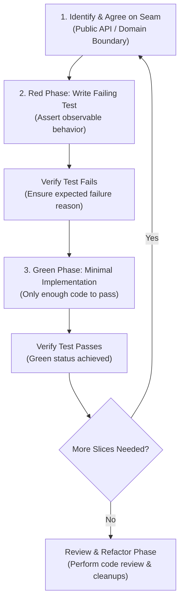

# Test-Driven Development (TDD) Skill

A disciplined, behavior-focused guide and operational framework for executing the **Red → Green** development cycle in software engineering and automated agent workflows.

---

## Overview

This skill establishes the engineering standards and operational rules that ensure the TDD loop produces robust, maintainable test suites. Rather than treating testing as an afterthought or generating large batches of brittle tests, this skill enforces behavior-oriented verification across pre-agreed seams.

### Core Philosophy

1. **Verify Behavior, Not Implementation**: Tests must verify observable behavior through public interfaces. Implementation code can be rewritten from scratch; as long as the behavior remains unchanged, tests should not break.
2. **Tests as Specifications**: A test suite serves as living, executable documentation. Test names describe capabilities and outcomes (e.g., `"user can checkout with valid cart"`) rather than internal steps (e.g., `"calls paymentService.process"`).
3. **Pre-Agreed Seams**: A seam is the public boundary at which behavior is observed without reaching into internals. Tests live strictly at seams. Before writing any tests, seams must be agreed upon to focus effort on critical business logic and prevent testing implementation details.
4. **Vertical Slices (Tracer Bullets)**: Avoid horizontal slicing (writing all tests upfront before any implementation). Instead, implement vertically in small increments: one seam, one failing test, one minimal implementation, repeat.
5. **System-Boundary Mocking Only**: Mock only external boundaries outside your control (payment gateways, third-party APIs, time/randomness, network). Never mock internal collaborators, helper classes, or modules you own.
6. **No Tautological Tests**: Expected values must originate from an independent source of truth (specifications, fixtures, known literals), never by recomputing the logic identical to the code under test.
7. **Decouple Refactoring from the Red-Green Loop**: The loop is strictly Red → Green. Code cleanup and structural refactoring are deferred to the review stage (e.g., via the `code-review` skill).

### When to Use This Skill

- Building new features or APIs from the ground up test-first.
- Fixing bugs by reproducing the failure with a test before writing the fix.
- Developing with AI agents to ensure code changes satisfy verifiable criteria without speculative code or hallucinations.
- When the user mentions "TDD", "red-green-refactor", or requests unit/integration test coverage.

---

## Workflow & Architecture

The TDD process follows a strict vertical slice cycle:



### Process Breakdown

1. **Seam Agreement**: Determine the public boundary under test. Confirm the seam and vocabulary with domain documentation (`CONTEXT.md` or architecture decisions).
2. **Red Phase**:
   - Write a single failing test at the agreed seam.
   - Assert observable outcomes against independent known-good values.
   - Run the test runner to verify it fails for the expected reason (not due to syntax errors or missing imports).
3. **Green Phase**:
   - Write the minimum amount of code necessary to satisfy the test.
   - Avoid speculative abstractions, unnecessary configurations, or unrequested features.
   - Re-run the test to confirm it turns green.
4. **Iterate Vertically**:
   - Repeat the cycle with the next test case or edge case.
   - Each cycle builds directly on lessons learned from the previous cycle.
5. **Post-Loop Review**:
   - Clean up style and structure during the dedicated review phase rather than mutating the red-green cycle.

---

## Required Dependencies & Installation Links

To execute tests within this framework, ensure your environment has the appropriate language runtime and test runner installed.

### Test Runners & Frameworks

| Ecosystem | Tool | Official Installation & Guide | Command-Line Install |
| :--- | :--- | :--- | :--- |
| **Python** | [pytest](https://docs.pytest.org/) | [pytest Installation Guide](https://docs.pytest.org/en/stable/getting-started.html) | `pip install pytest` or `uv add --dev pytest` |
| **JavaScript / TypeScript** | [Vitest](https://vitest.dev/) | [Vitest Getting Started](https://vitest.dev/guide/) | `npm install -D vitest` or `pnpm add -D vitest` |
| **JavaScript / TypeScript** | [Jest](https://jestjs.io/) | [Jest Getting Started](https://jestjs.io/docs/getting-started) | `npm install -D jest @types/jest ts-jest` |
| **Rust** | [cargo test](https://doc.rust-lang.org/cargo/commands/cargo-test.html) | [Rust Official Installation](https://www.rust-lang.org/tools/install) | Bundled with Rust toolchain (`rustup`) |
| **Go** | [testing](https://pkg.go.dev/testing) | [Go Official Installation](https://go.dev/doc/install) | Bundled with Go standard library |
| **Java** | [JUnit 5](https://junit.org/junit5/) | [JUnit 5 User Guide](https://junit.org/junit5/docs/current/user-guide/) | Added to `pom.xml` (Maven) or `build.gradle` |

### Environment Runtimes

- [Python 3.8+](https://www.python.org/downloads/)
- [Node.js (LTS)](https://nodejs.org/en/download/)
- [Rust Toolchain (rustup)](https://rustup.rs/)
- [Go Tools](https://go.dev/dl/)

---

## Usage & Examples

### 1. Developer or Agent Workflow

When applying this skill in an automated session or manual pairing:

1. **Consult Project Context**: Read `CONTEXT.md` (if available) to ensure test names match ubiquitous domain language.
2. **Formulate Seams**: State your assumptions and confirm the public interface:
   ```markdown
   "We are testing at the `OrderService` interface seam.
   Observable behavior: An order status transitions to 'confirmed' upon successful payment."
   ```
3. **Execute Red**: Create test file and execute the runner.
4. **Execute Green**: Write the simplest functional implementation.

---

### 2. Concrete Examples

#### Good Test: Tests Observable Behavior at a Public Seam

```typescript
// GOOD: Tests user-observable capability without caring about internal wiring
test("user can checkout with valid cart", async () => {
  const cart = createCart();
  cart.add({ id: "item-1", price: 50 });

  const result = await checkout(cart, mockPaymentGateway);

  expect(result.status).toBe("confirmed");
  expect(result.total).toBe(50);
});
```

#### Bad Test: Coupled to Implementation Details

```typescript
// BAD: Coupled to private implementation details and internal collaborators
test("checkout calls paymentService.process", async () => {
  const mockPayment = jest.mock(paymentService);
  await checkout(cart, mockPayment);

  // Breaks if internal method name or calling structure changes!
  expect(mockPayment.process).toHaveBeenCalledWith(cart.total);
});
```

#### Mocking at System Boundaries

Design interfaces with Dependency Injection to mock external services cleanly:

```typescript
// GOOD: External payment processor injected at system boundary
interface PaymentGateway {
  charge(amount: number): Promise<{ success: boolean; transactionId: string }>;
}

async function processOrder(order: Order, paymentGateway: PaymentGateway) {
  const payment = await paymentGateway.charge(order.total);
  if (!payment.success) {
    throw new Error("Payment failed");
  }
  return { orderId: order.id, status: "confirmed", transactionId: payment.transactionId };
}
```

---

## File Structure

The skill directory contains the core rules and detailed guides for test authoring and mocking:

```
test-driven-development/
├── SKILL.md       # Skill definition, loop rules, seam guidelines, and anti-patterns
├── tests.md       # Detailed breakdown of good vs. bad tests and tautological traps
├── mocking.md     # Rules on when and how to mock at system boundaries
└── README.md      # Comprehensive skill documentation and reference manual
```

### Referenced Companion Files

- [SKILL.md](./SKILL.md): Read during cycle initialization to review core rules, anti-patterns, and seam requirements.
- [tests.md](./tests.md): Detailed comparison tables and code snippets demonstrating observable vs. implementation-coupled tests.
- [mocking.md](./mocking.md): Patterns for designing mockable interfaces, using dependency injection, and avoiding mocks for internal collaborators.
