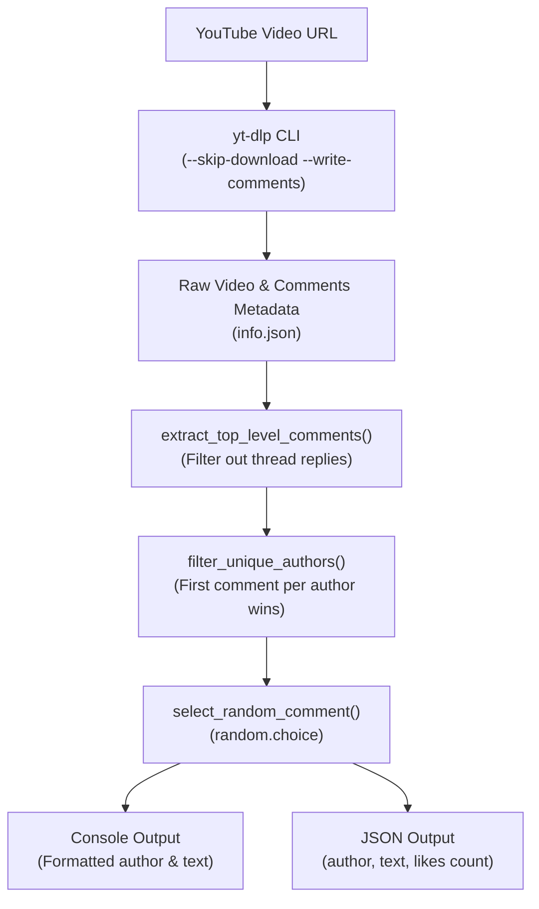

# YouTube Random Comment Picker Skill

A lightweight, automated utility and agent skill that downloads comments from any public YouTube video, filters them to retain one top-level comment per unique author, and randomly selects an unbiased winner.

---

## Overview

The `yt-random-comment-picker` skill enables developers and autonomous AI agents to select winners for YouTube giveaways, contests, raffles, and community drawings. By relying on `yt-dlp` to extract comments and metadata directly, it operates without requiring Google Cloud project setup, API credentials, or OAuth tokens.

### Core Philosophy

1. **Fair Participation (One Author = One Entry)**: To prevent giveaway spamming, the tool filters out repeated submissions by the same user. The first comment encountered per author is preserved, while all subsequent submissions by that author are discarded.
2. **Top-Level Consideration**: Thread replies and nested responses are excluded, ensuring that only genuine primary reactions to the video participate in the drawing.
3. **True Randomization**: Every unique author in the pool has an equal mathematical probability of being selected using Python's pseudo-random number generator (`random.choice`).
4. **Zero Media Footprint**: Downloads only the metadata and comment threads (`--skip-download`), avoiding bandwidth overhead and local video storage.
5. **Dual Output Format**: Produces clean terminal formatting for immediate inspection alongside structured JSON for automated pipelines and agent consumers.

### When to Use This Skill

- Running giveaways, lotteries, and contests on YouTube videos.
- Picking a random question or topic submitted by viewers for Q&A sessions.
- Sampling comments randomly for qualitative sentiment analysis or user research.
- Invoking as an AI skill when a user asks to "pick a random winner from this YouTube link".

---

## Workflow & Architecture

The following diagram illustrates how video comments are fetched, processed, and selected:



### Execution Steps

1. **Download Comments (`download_comments`)**: Executes `yt-dlp` in a subprocess with `--skip-download --write-comments` targeting `/tmp/youtube_comments.info.json`.
2. **Extract Top-Level Comments (`extract_top_level_comments`)**: Parses the generated JSON metadata and filters top-level comments, discarding nested comment replies.
3. **Deduplicate Authors (`filter_unique_authors`)**: Iterates through comments while tracking seen usernames in a hash set to enforce the single-entry rule.
4. **Random Selection (`select_random_comment`)**: Chooses one comment uniformly at random from the filtered candidate list.
5. **Output Generation**: Prints an ASCII summary box followed by an indented JSON object.

---

## Required Dependencies & Installation Links

This skill requires **Python 3** and **yt-dlp** installed and accessible in the system `PATH`.

### Required Binaries & Libraries

| Tool | Minimum Version | Description | Official Installation Link |
| :--- | :--- | :--- | :--- |
| **yt-dlp** | Latest Recommended | CLI tool for extracting YouTube video metadata and comments | [yt-dlp Installation Guide](https://github.com/yt-dlp/yt-dlp#installation) |
| **Python** | 3.6+ | Execution environment for the picker script (uses standard libraries only) | [Python Downloads](https://www.python.org/downloads/) |

### Command-Line Installation Examples

#### 1. Installing `yt-dlp`

- **macOS (via Homebrew)**:
  ```bash
  brew install yt-dlp
  ```
- **Linux / macOS / Windows (via pip / pipx)**:
  ```bash
  pip install --upgrade yt-dlp
  # Or via pipx:
  pipx install yt-dlp
  ```
- **Direct Standalone Binary (Linux/macOS)**:
  ```bash
  sudo curl -L https://github.com/yt-dlp/yt-dlp/releases/latest/download/yt-dlp -o /usr/local/bin/yt-dlp
  sudo chmod a+rx /usr/local/bin/yt-dlp
  ```

#### 2. Installing Python 3

- **macOS (Homebrew)**:
  ```bash
  brew install python
  ```
- **Ubuntu / Debian**:
  ```bash
  sudo apt update && sudo apt install -y python3
  ```

> [!NOTE]
> `pick_comment.py` relies exclusively on Python standard library modules (`json`, `random`, `sys`, `subprocess`, `typing`). No additional `pip` dependencies are required.

---

## Usage & Examples

### 1. Developer CLI Execution

Run the script directly by passing any standard or shortened YouTube video URL:

```bash
python pick_comment.py https://www.youtube.com/watch?v=VIDEO_ID
```

Or with a shortened `youtu.be` link:

```bash
python pick_comment.py https://youtu.be/VIDEO_ID
```

### 2. Skill Invocation by AI Agents

When registered in an agent framework (such as Antigravity), agents invoke the skill command directly:

```bash
yt-random-comment-picker https://youtu.be/VIDEO_ID
```

### 3. Example Terminal Output

```
Downloading comments from: https://youtu.be/dQw4w9WgXcQ
This may take a moment while yt-dlp fetches the comment section...

Video has 1420 total comments
Extracted 850 top-level comments
After filtering to unique authors: 780 comments

============================================================
RANDOMLY SELECTED COMMENT
============================================================
Author: @CreativeViewer42
Comment: This tutorial solved my setup problem completely, thank you!
============================================================

JSON output:
{
  "author": "@CreativeViewer42",
  "text": "This tutorial solved my setup problem completely, thank you!",
  "likes": 12
}
```

---

## File Structure

The skill directory contains the skill definition and Python execution script:

```
yt-random-comment-picker/
├── SKILL.md          # Skill metadata, trigger criteria, and parameter specifications
├── pick_comment.py   # Standalone Python script executing the download and selection logic
└── README.md         # Comprehensive skill documentation and installation guide
```

### Referenced Companion Files

- [SKILL.md](./SKILL.md): Declares the skill name, trigger description, parameter syntax, and format constraints for agent orchestration.
- [pick_comment.py](./pick_comment.py): Core executable containing `download_comments()`, `extract_top_level_comments()`, `filter_unique_authors()`, and `select_random_comment()`.
